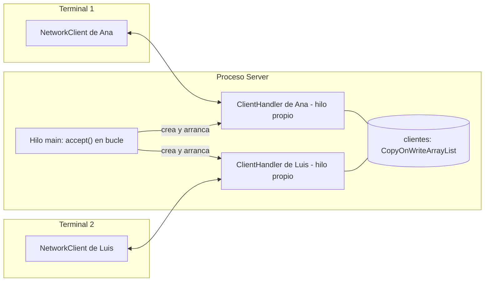
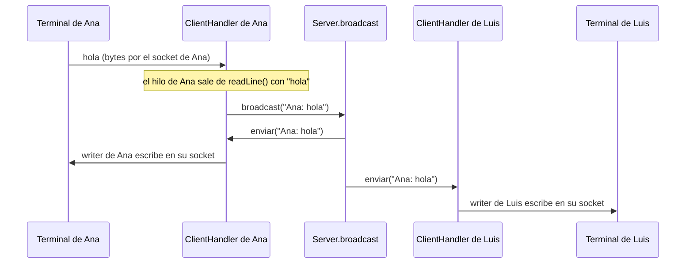
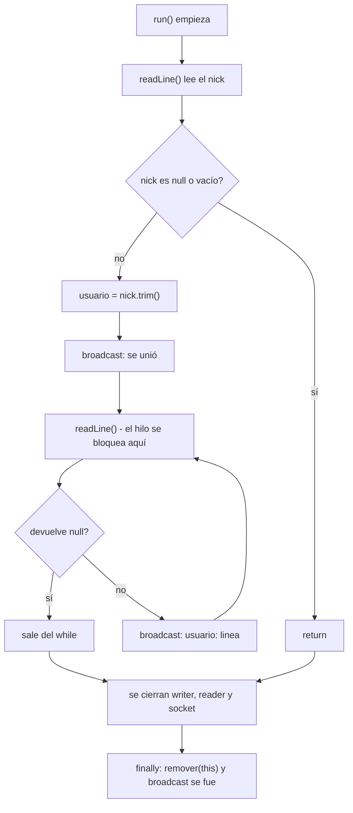
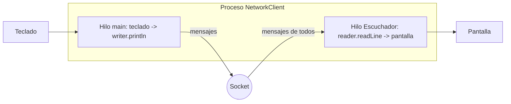

# Fase 2 — Chat multicliente con hilos

> Proyecto **Chat-Application** (Java, sockets, JavaFX).
> Objetivo de esta fase: **N clientes en el mismo PC, y lo que escribe uno lo ven todos.**

## Índice

1. Objetivo y resultado final
2. Qué cambia respecto a la Fase 1
3. Conceptos nuevos: bloqueo, hilos, concurrencia
4. Arquitectura y recorrido de un mensaje
5. El protocolo del chat
6. `Server.java`
7. `ClientHandler.java`
8. `NetworkClient.java`
9. Traza completa: qué pasa y en qué hilo
10. Qué ocurre en cada tipo de desconexión
11. Cómo compilar, ejecutar y probar
12. Errores típicos y cómo diagnosticarlos
13. Revisión de tu código: correcciones y aclaraciones
14. Limitaciones conocidas y mejoras
15. Qué prepara esta fase para las siguientes
16. Glosario
17. Preguntas de repaso (con respuestas)

---

## 1. Objetivo y resultado final

Al terminar la Fase 2 puedes abrir **un servidor** y **varios clientes** (cada uno en su terminal). Cada cliente elige un nombre, y todo lo que escribe cualquiera lo ven todos.

Ejemplo de lo que ve **Ana** en su terminal:

```
Conectado al servidor con ip: 127.0.0.1 con puerto :5000
 Escribe tu username: Ana
Ana se unio
Luis se unio
hola
Ana: hola
Luis: buenas, Ana
Luis se fue de la conversacion
```

Observaciones del ejemplo:

- `hola` es lo que Ana tecleó; `Ana: hola` es lo que **le devuelve el servidor**. El mensaje propio también vuelve porque `broadcast` reparte a **todos** los de la lista, incluido el emisor.
- `Ana se unio` y `Luis se unio` los genera el servidor al leer el nombre de cada cliente.
- `Luis se fue de la conversacion` aparece cuando Luis escribe `/salir` o cierra su terminal.

---

## 2. Qué cambia respecto a la Fase 1

| Aspecto | Fase 1 | Fase 2 |
|---|---|---|
| Clientes atendidos | Uno | N a la vez |
| Quién habla con el cliente | El `main` del servidor, directamente | Un `ClientHandler` por cliente, en su propio hilo |
| `accept()` | Se llama una vez | Se llama en un bucle infinito |
| `atenderCliente(socket)` | Existía en `Server` | **Desaparece**: su lógica vive ahora en `ClientHandler.run()` |
| Lectura en el servidor | Una sola línea | Bucle hasta que `readLine()` devuelve `null` |
| Lista de clientes | No había | `CopyOnWriteArrayList<ClientHandler>` |
| Reparto de mensajes | Respuesta fija "Mensaje recibido" | `broadcast` a todos |
| Cliente | Por turnos: escribe → envía → espera respuesta | **Dos hilos**: uno lee el teclado, otro escucha al servidor |
| Protocolo | Ninguno | La primera línea es el nombre de usuario |
| Clases | `Server`, `NetworkClient` | `Server`, `ClientHandler`, `NetworkClient` |

Idea clave: **`ClientHandler` no sustituye al cliente.** Vive solo en el servidor y es "el representante" de cada cliente dentro de él. Los clientes siguen siendo `NetworkClient`, un programa por terminal.

---

## 3. Conceptos nuevos: bloqueo, hilos, concurrencia

### 3.1 Llamadas que bloquean

Algunas llamadas **se quedan esperando** hasta que ocurre algo. Mientras esperan, el hilo que las ejecutó no avanza:

| Llamada | Dónde | Espera a que... |
|---|---|---|
| `serverSocket.accept()` | Servidor | llegue un cliente nuevo |
| `reader.readLine()` | Servidor y cliente | llegue una línea completa (o se cierre la conexión) |
| `teclado.nextLine()` | Cliente | el usuario escriba y pulse Enter |

En la Fase 1 esto no era problema porque todo ocurría por turnos. En la Fase 2 sí: si el servidor está esperando en `readLine()` de Ana, no puede estar a la vez en `accept()` esperando a Luis. Y si el cliente está esperando el teclado, no puede mostrar lo que escribe otro.

> Importante: una llamada bloqueante solo detiene **el hilo que la ejecuta**, no "la clase" ni "el programa". Los demás hilos siguen trabajando.

### 3.2 Hilos: el cocinero y la receta

Analogía: un programa normal es **un cocinero** que hace una cosa a la vez. Si espera a que hierva el agua, se queda mirando la olla. Un **hilo** (*thread*) es **otro cocinero** en la misma cocina.

En Java hay dos piezas:

| Pieza | Analogía | Qué es |
|---|---|---|
| `Runnable` | La **receta** | Interfaz con un único método, `run()`. Lo que escribas dentro es lo que hará el hilo |
| `Thread` | El **cocinero** | Objeto que ejecuta una receta por su cuenta cuando llamas a `start()` |

```java
Runnable receta = new Contador();            // la receta
Thread cocinero = new Thread(receta, "A");   // el cocinero con su receta
cocinero.start();                            // empieza a cocinar y yo sigo con lo mío
```

### 3.3 `start()` frente a `run()`

| Llamada | Qué ocurre |
|---|---|
| `hilo.start()` | Crea un hilo nuevo del sistema que ejecuta `run()`. **Devuelve el control al instante**: el hilo llamador sigue con la línea siguiente |
| `receta.run()` | Es una llamada normal a un método. Se ejecuta **en el hilo actual** y hay que esperar a que termine |

Por eso en el servidor se escribe `new Thread(handler).start()` y no `handler.run()`: con `run()` el `main` se quedaría atendiendo a un solo cliente y no volvería a `accept()`.

Esto lo comprobaste en `HiloDemo`: con `start()` los dos hilos cuentan a la vez y con nombres distintos; con `run()` todo se ejecuta uno detrás de otro dentro del hilo `main`.

### 3.4 Un hilo por cada espera

La solución a los bloqueos es que **cada espera tenga su propio hilo**:

| Programa | Hilo | Se bloquea en |
|---|---|---|
| Servidor | `main` | `accept()` |
| Servidor | Hilo de cada `ClientHandler` | su `readLine()` |
| Cliente | `main` | `teclado.nextLine()` |
| Cliente | Hilo `Escuchador` | `reader.readLine()` |

### 3.5 Hilos *daemon*

Un hilo *daemon* es un hilo "de servicio": **no mantiene vivo el programa**. Java termina la ejecución cuando solo quedan hilos daemon. En el cliente, el `Escuchador` se marca así para que, si `main` ya terminó, el programa pueda cerrarse aunque ese hilo siguiera bloqueado en `readLine()`.

`setDaemon(true)` tiene que llamarse **antes** de `start()`; después lanza una excepción.

### 3.6 Concurrencia: varios hilos tocando los mismos datos

Cuando varios hilos usan **el mismo objeto a la vez** pueden aparecer errores difíciles de reproducir (*condiciones de carrera*). En este proyecto hay dos objetos compartidos:

1. **La lista `clientes`**: el `main` añade clientes, los hilos de los handlers los quitan, y cualquiera la recorre en `broadcast`.
2. **El `writer` de cada cliente**: el hilo de Ana y el de Luis pueden querer escribir en el writer de Marta al mismo tiempo.

Las soluciones usadas:

| Problema | Solución | Dónde |
|---|---|---|
| Lista modificada y recorrida a la vez | `CopyOnWriteArrayList` | `Server.clientes` |
| Dos hilos escribiendo en el mismo writer | `synchronized (writer)` | `ClientHandler.enviar` |

### 3.7 `ArrayList` frente a `CopyOnWriteArrayList`

| Característica | `ArrayList` | `CopyOnWriteArrayList` |
|---|---|---|
| Seguridad entre hilos | **No** es segura. Si un hilo recorre y otro modifica, puede lanzar `ConcurrentModificationException` o dar datos inconsistentes | Segura para recorrer y modificar desde varios hilos |
| Al modificar (`add`, `remove`) | Modifica su array interno directamente | **Copia todo el array** en cada modificación (más caro) |
| Al recorrer | Muy rápido, pero sensible a cambios simultáneos | Rápido y seguro: recorre una "foto" estable del array |
| Cuándo conviene | Un solo hilo, o accesos protegidos por otro mecanismo | Muchas lecturas/recorridos y pocas modificaciones |

En un chat se recorre la lista **cada vez que alguien escribe** (muchas lecturas) y se modifica solo cuando alguien entra o sale (pocas escrituras). Es exactamente el caso ideal.

Detalles útiles:

- El recorrido de un `CopyOnWriteArrayList` trabaja sobre una **instantánea**: si alguien entra o sale mientras haces `broadcast`, esa pasada no lo ve, pero tampoco falla.
- `ConcurrentModificationException` puede aparecer incluso con **un solo hilo** si borras elementos de un `ArrayList` dentro de un `for-each`. No es solo un problema de concurrencia.

### 3.8 `synchronized`

`synchronized (objeto) { ... }` significa: *"para entrar en este bloque hay que tener el candado de ese objeto; si otro hilo lo tiene, espero mi turno"*. Es **exclusión mutua**: solo un hilo a la vez ejecuta el bloque con ese mismo objeto.

---

## 4. Arquitectura y recorrido de un mensaje

### 4.1 Quién es quién



Cada flecha doble `<-->` es un **socket**: un canal con dos extremos. Cada cliente tiene **su** socket y, al otro lado, un `ClientHandler` que lo gestiona.

### 4.2 Recorrido de un mensaje

Ana escribe `hola` y Luis lo recibe:



Lo más importante de este diagrama: **todo el recorrido lo hace el hilo del handler de Ana**, incluido el `enviar()` que escribe en el socket de Luis. El hilo de Luis no se ha movido de su `readLine()`.

### 4.3 Responsabilidades

| Clase | Hilo(s) | Responsabilidad |
|---|---|---|
| `Server` | `main` | Abrir el puerto, aceptar clientes, crear y arrancar un handler por cliente, guardar la lista, repartir con `broadcast`, quitar clientes con `remover` |
| `ClientHandler` | Uno por cliente | Leer lo que envía **su** cliente, pedir al servidor que lo reparta y escribir en **su** socket cuando le llegue un mensaje (`enviar`) |
| `NetworkClient` | `main` + `Escuchador` | Conectar, pedir el nombre, enviar lo que se teclea y mostrar lo que llega |

---

## 5. El protocolo del chat

Cliente y servidor tienen que ponerse de acuerdo en **qué significa cada línea**. Reglas actuales:

| Regla | Quién la cumple |
|---|---|
| Los mensajes son **líneas de texto** terminadas en salto de línea, codificadas en UTF-8 | Ambos (`println` / `readLine`) |
| La **primera línea** que envía el cliente es su nombre de usuario | Cliente la envía, `ClientHandler` la lee |
| Cada línea posterior es un mensaje para todos | `ClientHandler` la reparte con `broadcast` |
| `readLine()` devuelve `null` si el otro extremo cerró la conexión | Ambos lo interpretan como "desconectado" |
| El comando local `/salir` hace que el cliente cierre la conexión | Solo `NetworkClient` lo entiende; el servidor nunca lo ve |

Por qué se necesita un salto de línea: `readLine()` no termina hasta recibir `\n`. `println` lo añade solo; `print` no.

---

## 6. `Server.java`

### 6.1 Código

```java
package com.mycompany.chat.server;

import java.io.IOException;
import java.net.ServerSocket;
import java.net.Socket;
import java.util.List;
import java.util.concurrent.CopyOnWriteArrayList;

public class Server {

    private static final int PORT = 5000;

    private final List<ClientHandler> clientes = new CopyOnWriteArrayList<>();

    public static void main(String[] args) {
        new Server().iniciar();
    }

    public void iniciar() {
        try (ServerSocket serverSocket = new ServerSocket(PORT)) {
            System.out.println("Servidor escuchando en el puerto " + PORT);

            while (true) {
                Socket socket = serverSocket.accept();
                try {
                    ClientHandler handler = new ClientHandler(socket, this);
                    clientes.add(handler);
                    new Thread(handler).start();

                    System.out.println("Cliente conectado: " + socket.getInetAddress()
                            + " | Total conectados: " + clientes.size());
                } catch (IOException e) {
                    System.err.println("Error al preparar al cliente: " + e.getMessage());
                    cerrarSocketIndividual(socket);
                }
            }
        } catch (IOException e) {
            System.err.println("Error en el servidor: " + e.getMessage());
        }
    }

    void broadcast(String mensaje) {
        for (ClientHandler handler : clientes) {
            handler.enviar(mensaje);
        }
    }

    void remover(ClientHandler handler) {
        if (clientes.remove(handler)) {
            System.out.println("Cliente desconectado. Quedan " + clientes.size());
        }
    }

    private static void cerrarSocketIndividual(Socket socket) {
        try {
            socket.close();
        } catch (IOException e) {
            // Ignorado a propósito.
        }
    }
}
```

### 6.2 Imports

Solo se necesitan los cinco que aparecen arriba. Los de `BufferedReader`, `InputStreamReader`, `PrintWriter` y `StandardCharsets` eran de la Fase 1, cuando el servidor hablaba con el cliente directamente. Ahora esa tarea es de `ClientHandler`, y si los dejas el editor los marca como no usados.

### 6.3 ¿Qué es un socket?

Es el "enchufe" de comunicación virtual, formado por **IP + puerto**, que permite que dos programas se envíen y reciban datos a través de la red. Hay dos tipos de objeto en juego:

| Objeto | Para qué sirve |
|---|---|
| `ServerSocket` | Solo **espera conexiones nuevas** en un puerto. No intercambia mensajes con nadie |
| `Socket` | El canal real con **un cliente concreto**. Por él viajan los mensajes |

La dirección completa para encontrar al servidor se forma uniendo la IP del equipo y el puerto, por ejemplo `127.0.0.1:5000`. En la Fase 1 y 2 la IP es siempre la misma porque todo ocurre en el mismo PC (`127.0.0.1` es "esta máquina").

### 6.4 Qué guarda el `Socket` de un cliente

Cuando `accept()` devuelve un `Socket`, ese objeto conoce los datos de la conexión:

| Dato | Qué es | Ejemplo | Cómo se obtiene |
|---|---|---|---|
| IP del cliente | Dirección desde la que conectó | `127.0.0.1` (mismo PC en las fases 1 y 2) | `socket.getInetAddress()` |
| Puerto del cliente | Puerto **efímero** que le asigna el sistema operativo; cambia en cada conexión | `54321` | `socket.getPort()` |
| IP del servidor | Dirección local del servidor | `127.0.0.1` | `socket.getLocalAddress()` |
| Puerto del servidor | Puerto donde escucha | `5000` | `socket.getLocalPort()` |
| Canal de entrada | Para leer datos del cliente | | `socket.getInputStream()` |
| Canal de salida | Para escribir datos al cliente | | `socket.getOutputStream()` |

Fíjate en que `getInetAddress()` devuelve la dirección **del otro extremo** (el cliente), y por eso en `iniciar()` se imprime como "Cliente conectado".

### 6.5 `PORT`

Constante con el puerto donde escucha el servidor. El cliente tiene que usar **el mismo número** para conectarse. Si el puerto está ocupado (por ejemplo, por otra ejecución anterior del servidor), `new ServerSocket(PORT)` lanza una `IOException` con el mensaje `Address already in use`.

### 6.6 La lista `clientes`

```java
private final List<ClientHandler> clientes = new CopyOnWriteArrayList<>();
```

Cada parte tiene un motivo:

| Parte | Por qué |
|---|---|
| Campo de **instancia** (no `static`) | Cada `ClientHandler` recibe una referencia al `Server` mediante `this`, así que no hace falta que sea estática |
| `final` | La **variable** siempre apunta a la misma lista. Lo que cambia es su **contenido**: la lista sí es mutable |
| Tipo `List<ClientHandler>` | Se programa contra la **interfaz**. Puedes usar `add`, `remove`, `size`, recorrerla con `for-each`... y por debajo se ejecuta la lógica de `CopyOnWriteArrayList` |
| Objeto `CopyOnWriteArrayList` | Es la implementación segura para varios hilos (ver apartado 3.7) |

### 6.7 `main` e `iniciar()`: por qué hay un objeto

`main` es `static` y por tanto **no puede usar campos de instancia** como `clientes`. Por eso solo crea un `Server` y le pide que arranque con `new Server().iniciar()`. El trabajo real está en `iniciar()`, que es un método normal.

¿Se podría hacer todo `static`? Sí, y funcionaría. Tendrían que ser estáticos `clientes`, `iniciar`, `broadcast` y `remover`, y `new ClientHandler(socket, this)` dejaría de compilar porque en un método estático no existe `this`. Se prefiere el objeto porque:

- **Las dependencias se ven**: el handler recibe el servidor y se sabe que lo necesita.
- **No hay estado global mutable**: la lista no queda accesible desde cualquier clase.
- **Se pueden crear varios servidores** (en pruebas, o en dos puertos).
- El coste es una sola línea.

En un proyecto pequeño la versión estática no falla; es una cuestión de limpieza y de hábito.

### 6.8 `try (ServerSocket serverSocket = ...)`

Es un *try-with-resources*: el `ServerSocket` se cierra **automáticamente** al salir del bloque, aunque haya una excepción. Así no dejas el puerto 5000 ocupado.

### 6.9 `while (true)` y `accept()`

> **Diferencia clave con la Fase 1:** ahora hay un bucle infinito para encargarse de cada cliente.

`accept()` **bloquea** el hilo `main` hasta que alguien se conecta y devuelve el `Socket` **de ese cliente**. Después de crear su handler y arrancar su hilo, el `main` vuelve a `accept()` esperando al siguiente. Mientras tanto, cada cliente ya conectado es atendido por su propio hilo.

Para parar el servidor se usa `Ctrl+C` en su terminal.

### 6.10 El `try/catch` interior

```java
try {
    ClientHandler handler = new ClientHandler(socket, this);
    ...
} catch (IOException e) {
    ...
    cerrarSocketIndividual(socket);
}
```

El constructor de `ClientHandler` puede lanzar `IOException` al abrir los flujos del socket. Si no lo capturaras aquí, la excepción saltaría al `catch` de fuera y **el servidor entero dejaría de aceptar clientes por culpa de uno**. Con este `try/catch` se descarta solo a ese cliente y el servidor sigue vivo para el siguiente.

### 6.11 Por qué se añade a la lista **antes** de `start()`

```java
clientes.add(handler);          // 1.º
new Thread(handler).start();    // 2.º
```

Si se hiciera al revés podría ocurrir esta secuencia, con un cliente que se desconecta al instante:

| Paso | Hilo | Qué pasa |
|---|---|---|
| 1 | `main` | Arranca el hilo del handler |
| 2 | Hilo del handler | El cliente ya se fue: `readLine()` devuelve `null`, va al `finally` y llama a `remover(this)`. **No estaba en la lista**, así que no borra nada |
| 3 | `main` | Ahora sí hace `clientes.add(handler)` |
| Resultado | | Queda un **cliente muerto en la lista para siempre**; cada `broadcast` intentará escribirle |

Añadiéndolo antes de `start()`, el handler ya está en la lista cuando pueda intentar quitarse.

### 6.12 `new Thread(handler).start()`

- `handler` es un `ClientHandler`, que implementa `Runnable`: es la **receta** ("atender a este cliente").
- `new Thread(handler)` crea el **cocinero** y le entrega la receta.
- `start()` arranca el hilo y **devuelve el control al instante**. El hilo ejecutará `handler.run()` en paralelo mientras el `main` vuelve a `accept()`.

### 6.13 `broadcast`

```java
void broadcast(String mensaje) {
    for (ClientHandler handler : clientes) {
        handler.enviar(mensaje);
    }
}
```

Recorre la lista y llama a `enviar` en cada handler. No lleva `private` a propósito: `ClientHandler` está en el mismo paquete y necesita llamarlo. No necesita `synchronized` propio porque la lista ya es segura para recorrerla y `enviar` protege la escritura de cada cliente.

Lo llama **el hilo de cualquier handler** que haya recibido una línea, no el `main`.

### 6.14 `remover`

```java
void remover(ClientHandler handler) {
    if (clientes.remove(handler)) {
        System.out.println("Cliente desconectado. Quedan " + clientes.size());
    }
}
```

`remove` devuelve `true` solo si el elemento realmente estaba en la lista. Así el mensaje de "desconectado" no se imprime dos veces si por algún motivo se llamara repetido. Lo llama el `finally` de `ClientHandler`.

### 6.15 `cerrarSocketIndividual`

`socket.close()` también puede lanzar `IOException`. Si se llamara directamente dentro del `catch` interior, esa excepción nueva saldría al `catch` de fuera y **tumbaría el servidor**. Por eso se envuelve en un método aparte: si falla al cerrar, no hay nada más que hacer y se ignora.

### 6.16 `catch (Exception e)` frente a `catch (IOException e)`

En el `catch` exterior, `Exception` compila, pero es demasiado amplio: también capturaría errores de programación (un `NullPointerException`, por ejemplo) y los dejaría disfrazados de "Error en el servidor". Lo adecuado es capturar solo `IOException`, que es lo único que ese bloque puede lanzar legítimamente.


---

## 7. `ClientHandler.java`

### 7.1 Código

```java
package com.mycompany.chat.server;

import java.io.BufferedReader;
import java.io.IOException;
import java.io.InputStreamReader;
import java.io.PrintWriter;
import java.net.Socket;
import java.nio.charset.StandardCharsets;

// Implementamos Runnable para poder sobrescribir el método run()
public class ClientHandler implements Runnable {

    private final Socket socket;
    private final Server servidor;
    private final BufferedReader reader;
    private final PrintWriter writer;
    private String usuario;

    public ClientHandler(Socket socket, Server servidor) throws IOException {
        this.socket = socket;
        this.servidor = servidor;
        this.reader = new BufferedReader(
                new InputStreamReader(socket.getInputStream(), StandardCharsets.UTF_8));
        this.writer = new PrintWriter(socket.getOutputStream(), true, StandardCharsets.UTF_8);
    }

    @Override
    public void run() {
        try (socket; reader; writer) {
            String nick = reader.readLine();            // 1ª línea = nombre
            if (nick == null || nick.isBlank()) {
                return;
            }
            usuario = nick.trim();

            servidor.broadcast(usuario + " se unio");

            String linea;
            while ((linea = reader.readLine()) != null) {
                servidor.broadcast(usuario + ": " + linea);
            }
        } catch (IOException e) {
            System.err.println("Error con " + usuario + ": " + e.getMessage());
        } finally {
            servidor.remover(this);
            if (usuario != null) {
                servidor.broadcast(usuario + " se fue de la conversacion");
            }
        }
    }

    void enviar(String mensaje) {
        synchronized (writer) {
            writer.println(mensaje);
        }
    }
}
```

### 7.2 Qué es un `ClientHandler`

Es el **"camarero" asignado a un cliente**. Piensa en un restaurante: el servidor es el **portero**, que abre la puerta y entrega cada cliente que llega a un camarero que solo atiende a esa persona. Así el portero vuelve enseguida a la puerta y los camareros atienden por separado.

- Hay **uno por cliente conectado**.
- Cada uno se ejecuta en **su propio hilo**.
- `implements Runnable` significa "esta clase es una receta que un `Thread` puede ejecutar". Obliga a escribir un único método, `run()`.
- `@Override` avisa al compilador de que estás sobrescribiendo un método de la interfaz; si te equivocas en el nombre, da error en vez de crear un método distinto sin querer.

### 7.3 Los campos

| Campo | Tipo | Para qué sirve |
|---|---|---|
| `socket` | `final Socket` | El canal con **este** cliente |
| `servidor` | `final Server` | Referencia al servidor, para poder llamar a `broadcast()` y `remover()` |
| `reader` | `final BufferedReader` | Lee **lo que envía el cliente** (entrada al servidor) |
| `writer` | `final PrintWriter` | Escribe **lo que el servidor envía al cliente** (salida del servidor) |
| `usuario` | `String` (sin `final`) | El nombre del cliente. No es `final` porque se conoce **después** de crear el objeto: se asigna en `run()` al leer la primera línea |

Son campos y no variables locales porque se crean en el constructor y se usan en otros métodos (`run()` y `enviar()`).

### 7.4 El constructor

El constructor **no** lo ejecuta el hilo del cliente: lo ejecuta el hilo `main` del servidor (el portero), justo después de `accept()`. Todavía no se ha creado el hilo propio del handler. Lanza `IOException` porque `getInputStream()` y `getOutputStream()` pueden fallar, y por eso `Server` lo rodea con un `try/catch`.

#### Cadena de lectura (`reader`)

El `Socket` solo sabe mover **bytes**, números sueltos sin significado. Tú quieres leer **líneas de texto**. Cada clase se encarga de un solo salto, y se encadenan:

```
Socket (bytes crudos)  ->  InputStreamReader (bytes a letras, UTF-8)  ->  BufferedReader (letras a líneas)
```

Se lee de dentro hacia fuera:

| Pieza | Qué hace |
|---|---|
| `socket.getInputStream()` | La tubería de entrada. Por ella llegan bytes crudos, sin ningún significado todavía |
| `new InputStreamReader(..., UTF_8)` | El traductor de bytes a caracteres. `UTF_8` le dice **cómo** traducir. Una letra como la `ñ` ocupa dos bytes; sin indicarlo, que se vea bien dependería del ordenador |
| `new BufferedReader(...)` | Guarda lo que llega en un búfer y te da `readLine()`, que devuelve **una línea entera** hasta el salto de línea. Sin él tendrías que leer letra a letra y detectar tú los saltos |

Es como una cebolla: cada capa envuelve a la anterior y añade una habilidad.

#### Cadena de escritura (`writer`)

```java
new PrintWriter(socket.getOutputStream(), true, StandardCharsets.UTF_8)
```

| Parámetro | Qué es |
|---|---|
| `socket.getOutputStream()` | La corriente de salida cruda del socket: el canal por donde salen los bytes hacia el otro extremo |
| `true` (*autoflush*) | Vacía el búfer automáticamente en cada `println`, `printf` o `format`. Con `false`, el texto podría quedarse retenido en memoria hasta llenar el búfer o hasta que llamaras a `writer.flush()` |
| `StandardCharsets.UTF_8` | La codificación. Asegura que tildes, `ñ`, emojis y otros símbolos se conviertan en bytes siempre con UTF-8, sin depender de la configuración del sistema operativo |

Este constructor ya hace internamente todo lo que hace la cadena de lectura (convertir caracteres en bytes, con búfer), por eso aquí hay **una capa menos**.

> Este constructor `PrintWriter(OutputStream, boolean, Charset)` existe desde Java 10. Tu proyecto usa Java 17, así que está disponible.

#### El error clásico: anidar dos `PrintWriter`

```java
// MAL
writer = new PrintWriter(new PrintWriter(socket.getOutputStream(), true, StandardCharsets.UTF_8));
```

El `PrintWriter` interior tiene autoflush, pero el **exterior** se crea con un constructor que **no** lo activa. Cuando el exterior hace `println`, le pasa el texto al interior, y el autoflush del interior solo se dispara con sus **propios** `println`. El texto se queda atascado en el búfer y **el cliente nunca lo recibe**, sin ningún error visible. Usa **un solo** `PrintWriter`.

### 7.5 El método `run()`

`run()` lo ejecuta **el hilo propio de este cliente**, después de que el servidor llame a `start()`.

#### Diagrama de flujo



Si ocurre una `IOException` en cualquier punto del bloque, se pasa a los recursos cerrados y luego al `catch`, y por último al `finally`.

#### `try (socket; reader; writer)`

Es un *try-with-resources* que usa variables que **ya existían** (los campos de la clase), en vez de crearlas en la cabecera. Es válido desde Java 9, con la condición de que sean `final` o equivalentes a `final`.

- Al salir del bloque, Java **cierra los tres automáticamente**, en **orden inverso**: primero `writer`, luego `reader`, luego `socket`.
- Los recursos se cierran **antes** de ejecutar el `catch` y el `finally`.

#### La primera línea: el nombre

```java
String nick = reader.readLine();
if (nick == null || nick.isBlank()) { return; }
usuario = nick.trim();
```

- Es el **mini protocolo**: la primera línea es el nombre.
- `null` significa que el cliente se fue antes de presentarse.
- `isBlank()` es `true` si la cadena está vacía o solo tiene espacios.
- `trim()` elimina los espacios al principio y al final.
- Se usa primero una variable local `nick` y solo se copia a `usuario` cuando es válida. Así `usuario` vale `null` hasta que el cliente se presente, y el `finally` puede saber si merece un aviso de salida.

#### `return` dentro del `try`

Un `return` dentro de un `try` **no se salta el `finally`**: se cierran los recursos y se ejecuta `remover(this)` igualmente. Por eso el handler no queda colgado en la lista cuando alguien se va sin presentarse.

#### El bucle de lectura

```java
while ((linea = reader.readLine()) != null) {
    servidor.broadcast(usuario + ": " + linea);
}
```

- Asigna y comprueba en la misma condición.
- **Aquí se detiene el hilo de este cliente**, porque `readLine()` espera a recibir contenido. Solo se detiene **este** hilo: los demás handlers y el `main` siguen funcionando.
- La Fase 1 leía **una** línea y terminaba; ahora se repite hasta que el cliente se va (`readLine()` devuelve `null`).

#### `catch (IOException e)`

Salta si la conexión se rompe de golpe (por ejemplo, el cliente cierra la terminal a lo bruto). Imprime el error, y a continuación se ejecuta el `finally`.

#### `finally`: dos pasos, en este orden

```java
servidor.remover(this);                                  // 1.º
if (usuario != null) {                                   // 2.º
    servidor.broadcast(usuario + " se fue de la conversacion");
}
```

1. **Primero** se quita de la lista. Si se avisara antes, `broadcast` intentaría escribir también en este socket, que ya está cerrado.
2. **Después** se avisa a los demás, pero solo si llegó a presentarse.

Sin el `finally`, un cliente que se va dejaría un handler **muerto** en la lista, y cada `broadcast` posterior intentaría escribirle. `PrintWriter` no lanza excepciones al escribir en un socket cerrado (marca un error interno que se consulta con `checkError()`), así que el fallo sería **silencioso** y la lista seguiría creciendo.

#### Las cuatro formas de salir de `run()`

| Salida | Cuándo | ¿Pasa por `finally`? |
|---|---|---|
| `return` | El cliente se fue sin nombre | Sí |
| El `while` termina | `readLine()` devolvió `null` (desconexión normal) | Sí |
| `IOException` | La conexión se rompió | Sí |
| Excepción no controlada | Un error de programación | Sí (y el hilo muere con un mensaje) |

### 7.6 `enviar` y `synchronized`

```java
void enviar(String mensaje) {
    synchronized (writer) {
        writer.println(mensaje);
    }
}
```

Dos ideas que hay que tener claras:

1. **Cada cliente tiene su propio hilo** ejecutando `run()`, y cada handler tiene su **propio `reader` y `writer`**: el `reader` recibe lo que llega desde el cliente, el `writer` envía lo que el servidor manda **hacia** el cliente.
2. **Un hilo puede llamar a un método de un objeto que pertenece a otro cliente.**

Piensa en cada cliente unido al servidor por un cable de dos carriles: uno de entrada (`reader`) y otro de salida (`writer`).

#### Entrada y salida

- **Entrada al servidor (`reader`).** Ana escribe `Hola` en su programa. El dato viaja por la red hasta el servidor. En el `ClientHandler` de Ana, el `reader` lee ese mensaje.
- **Salida desde el servidor (`writer`).** El servidor quiere que a Luis le llegue `Ana: Hola` en su pantalla. En el `ClientHandler` de **Luis**, el `writer` escribe ese mensaje hacia el socket de Luis, y cruza la red hasta su programa.

#### Quién ejecuta qué, paso a paso

Cuando Ana y Luis entran, el servidor crea **dos handlers y dos hilos**. Ambos hilos están dentro de su `while ((linea = reader.readLine()) != null)`, esperando a que su cliente escriba.

Ana escribe `Hola`:

| Paso | Hilo que lo ejecuta | Qué ocurre |
|---|---|---|
| 1 | Hilo de Ana | Sale de `readLine()` con `linea = "Hola"` |
| 2 | Hilo de Ana | Llama a `servidor.broadcast("Ana: Hola")` |
| 3 | Hilo de Ana | `broadcast` recorre la lista. En el handler de Ana llama a `enviar` y escribe por el `writer` de Ana |
| 4 | Hilo de Ana | En el handler de **Luis** llama a `enviar` y escribe por el `writer` de Luis |
| 5 | Hilo de Luis | **Sigue bloqueado** en su `readLine()`. No ha hecho nada |

El hilo de Ana está ejecutando `enviar()` **dentro del objeto `ClientHandler` de Luis**. El hilo de Luis no se movió; fue el hilo de Ana el que entró en el método de Luis para mandarle el mensaje.

#### Por qué hace falta `synchronized`

Si Luis escribe `qué tal` casi al mismo tiempo, su hilo sale de su `readLine()` y también llama a `broadcast`, que recorre la lista y llama a `enviar` en todos. Entonces **dos hilos distintos** (el de Ana y el de Luis) pueden llamar a `enviar` del **mismo** handler a la vez, y por tanto escribir en el **mismo `writer`**.

`synchronized (writer)` obliga a ir **por turnos**: mientras un hilo está dentro del bloque, el otro espera. Así los mensajes no se entrelazan.

Dos matices:

- El candado es el **`writer` de cada handler**. Escribir en el writer de Luis y en el de Marta puede hacerse a la vez; solo se serializan las escrituras **hacia el mismo destinatario**.
- Hasta donde sé, `PrintWriter` ya protege internamente cada llamada a `println`, así que aquí el `synchronized` es una **red de seguridad** redundante pero inofensiva, y deja clara la idea de exclusión mutua.

#### El emisor también recibe su mensaje

`broadcast` reparte a **todos** los de la lista, incluido quien lo escribió. Es una decisión de diseño: simplifica el cliente (todo lo que ve en pantalla viene del servidor, en el mismo orden para todos). Si prefirieras no devolvérselo al emisor, `broadcast` tendría que recibir también el handler emisor y saltárselo.

---

## 8. `NetworkClient.java`

### 8.1 Código

```java
package com.mycompany.chat.client;

import java.io.BufferedReader;
import java.io.IOException;
import java.io.InputStreamReader;
import java.io.PrintWriter;
import java.net.Socket;
import java.nio.charset.StandardCharsets;
import java.util.Scanner;

public class NetworkClient {

    public static void main(String[] args) {
        String ipServidor = "127.0.0.1";   // la misma máquina (valor fijo por ahora)
        int puertoServidor = 5000;

        try (Socket socket = new Socket(ipServidor, puertoServidor);
             BufferedReader reader = new BufferedReader(
                     new InputStreamReader(socket.getInputStream(), StandardCharsets.UTF_8));
             PrintWriter writer = new PrintWriter(
                     socket.getOutputStream(), true, StandardCharsets.UTF_8);
             Scanner teclado = new Scanner(System.in)) {

            System.out.println("Conectado al servidor con ip: " + ipServidor
                    + " con puerto :" + puertoServidor);

            // FASE 2
            System.out.print(" Escribe tu username: ");
            String nombre = teclado.nextLine();
            writer.println(nombre);                      // 1ª línea = nombre

            // hilo que escucha al servidor
            Thread hiloEscucha = new Thread(new Escuchador(reader, socket));
            hiloEscucha.setDaemon(true);
            hiloEscucha.start();

            // hilo main: lee el teclado y envía
            while (teclado.hasNextLine()) {
                String mensaje = teclado.nextLine();
                if ("/salir".equalsIgnoreCase(mensaje)) {
                    break;
                }
                writer.println(mensaje);
            }

        } catch (IOException e) {
            System.err.println(" Error de conexión: " + e.getMessage());
            System.err.println("   ¿Está el servidor arrancado en "
                    + ipServidor + ":" + puertoServidor + "?");
        }
    }

    static class Escuchador implements Runnable {

        private final BufferedReader reader;
        private final Socket socket;

        Escuchador(BufferedReader reader, Socket socket) {
            this.reader = reader;
            this.socket = socket;
        }

        @Override
        public void run() {
            try {
                String linea;
                while ((linea = reader.readLine()) != null) {
                    System.out.println(linea);
                }
                // readLine() devolvió null: el servidor cerró la conexión
                System.out.println("El servidor cerro la conexion.");

            } catch (IOException e) {
                // Distinguir salida voluntaria (/salir) de caída real
                if (!socket.isClosed()) {
                    System.err.println("Se perdio la conexion: " + e.getMessage());
                }
            }
        }
    }
}
```

### 8.2 Por qué el cliente necesita dos hilos

En la Fase 1 el cliente actuaba **por turnos**: escribía, enviaba, esperaba la respuesta. Ahora el servidor puede enviarte un mensaje **en cualquier momento** (alguien más escribió), y el cliente tiene dos esperas a la vez:

| Hilo | Hace | Se bloquea en |
|---|---|---|
| `main` | Lee el teclado y envía al servidor | `teclado.nextLine()` |
| `Escuchador` | Lee del servidor y muestra por pantalla | `reader.readLine()` |

Con un solo hilo, mientras esperas al teclado no podrías ver lo que escriben los demás, y al revés.



### 8.3 `main`, paso a paso

| Paso | Código | Qué hace |
|---|---|---|
| 1 | `new Socket(ip, puerto)` | Se conecta al servidor. Si no está arrancado lanza `ConnectException` (subclase de `IOException`) |
| 2 | `reader`, `writer`, `teclado` | Los mismos recursos de la Fase 1 |
| 3 | `teclado.nextLine()` + `writer.println(nombre)` | Pide el nombre y lo envía como **primera línea** (el protocolo) |
| 4 | `new Thread(new Escuchador(...))` | Crea el hilo que escucha, con su receta |
| 5 | `setDaemon(true)` | Lo marca como hilo de servicio (antes de `start()`) |
| 6 | `start()` | Arranca el hilo. `main` sigue con la línea siguiente **al instante** |
| 7 | `while (teclado.hasNextLine())` | Bucle del hilo `main`: lee, comprueba `/salir`, envía |

Detalles:

- **`"/salir".equalsIgnoreCase(mensaje)`**: poner el literal primero evita un `NullPointerException` si `mensaje` fuera `null`, e ignora mayúsculas y minúsculas.
- **El hilo se arranca antes del bucle del teclado**, porque el bucle bloquea a `main`. Si arrancaras el hilo después, nunca llegaría a ejecutarse.
- **`reader.readLine()` ya no se usa en `main`**: eso lo hace el `Escuchador`.

### 8.4 La clase `Escuchador`

- Es una **clase anidada `static`**: no necesita acceder a ningún campo de `NetworkClient`, recibe lo que necesita por el constructor.
- Implementa `Runnable`, igual que `ClientHandler` y que el `Contador` de `HiloDemo`.
- Recibe el `reader` para leer, y el `socket` **solo para preguntar después si lo cerramos nosotros**.
- `run()` hace un bucle de lectura, igual que el del `ClientHandler`: imprime cada línea que llega (de **todos**, incluidos tus propios mensajes, que reparte el servidor).
- Si `readLine()` devuelve `null`, el servidor cerró la conexión y se avisa con un mensaje.

### 8.5 Cómo se cierra todo (`/salir`)

1. El bucle del `main` hace `break`.
2. El `main` llega al final del `try` y Java cierra los recursos en **orden inverso**: `teclado`, `writer`, `reader`, `socket`.
3. Cerrar el socket hace que el `readLine()` del `Escuchador`, que estaba esperando, **falle con una excepción** (`Socket closed`).
4. Ese `catch` comprueba `socket.isClosed()`:
   - **`true`**: lo cerramos nosotros con `/salir`. Es normal y no se muestra nada.
   - **`false`**: se perdió la conexión de verdad. Se muestra el error.
5. El `Escuchador` termina y el programa acaba.
6. En el servidor, el `readLine()` del handler de ese cliente devuelve `null`: se ejecuta su `finally` y se avisa a los demás.

`readLine()` **no se puede interrumpir de otra forma**: cerrar el socket es la manera de despertarlo.

Detalle avanzado: cerrar el `writer` cierra el flujo de salida del socket, y según la documentación de Java, eso cierra **también el socket**. Como el `writer` se cierra antes que el `reader` (orden inverso), el socket ya está cerrado cuando llega el turno del `reader`. Hasta donde sé, intentar cerrar un `BufferedReader` mientras otro hilo está bloqueado dentro de su `readLine()` puede quedarse esperando; en este orden no ocurre, pero conviene saber que **el orden de declaración de los recursos importa**.

### 8.6 Limitaciones del cliente

- **Si el servidor se cae**, el `Escuchador` avisa, pero el hilo `main` sigue bloqueado en `teclado.nextLine()` hasta que pulses Enter. Se puede resolver más adelante con más trabajo (por ejemplo, terminando el programa desde el `Escuchador`).
- **La IP y el puerto están fijos** (`127.0.0.1:5000`). Se parametrizarán en la Fase 3.
- **Si alguien escribe mientras tú tecleas**, su mensaje aparece mezclado con tu línea en la consola. Es normal en una terminal: se arreglará con la interfaz gráfica.

---

## 9. Traza completa: qué pasa y en qué hilo

Escenario: arrancas el servidor, entran Ana y Luis, Ana escribe `hola` y después se va con `/salir`.

| # | Evento | Hilo | Qué ocurre |
|---|---|---|---|
| 1 | Ejecutas `Server` | `main` del servidor | Abre `ServerSocket(5000)`, imprime "Servidor escuchando..." y se **bloquea en `accept()`** |
| 2 | Ana ejecuta `NetworkClient` | `main` del cliente de Ana | `new Socket(...)` conecta con el servidor |
| 3 | Llega la conexión de Ana | `main` del servidor | `accept()` **despierta** y devuelve el `Socket`. Crea el `ClientHandler` (abre reader y writer), lo **añade a la lista**, arranca su hilo, imprime "Cliente conectado..." y **vuelve a `accept()`** |
| 4 | Ana escribe su nombre | `main` del cliente de Ana | `writer.println("Ana")`, arranca el hilo `Escuchador` y entra en el bucle `nextLine()` |
| 5 | Llega el nombre | Hilo del handler de Ana | `readLine()` devuelve `"Ana"`. `usuario = "Ana"`. `broadcast("Ana se unio")` |
| 6 | Se reparte el aviso | Hilo del handler de Ana | `enviar` en el handler de Ana → escribe en su socket |
| 7 | Ana recibe el aviso | Hilo `Escuchador` de Ana | `readLine()` devuelve `"Ana se unio"` y lo imprime |
| 8 | Luis conecta y se presenta | (igual que 2–5 con su propio handler e hilos) | `broadcast("Luis se unio")` llega **a Ana y a Luis** |
| 9 | Ana escribe `hola` | `main` del cliente de Ana | `writer.println("hola")` |
| 10 | Llega a su handler | Hilo del handler de Ana | Sale de `readLine()`, `broadcast("Ana: hola")` |
| 11 | Se reparte | **Hilo del handler de Ana** | Llama a `enviar` en el handler de Ana **y en el de Luis** |
| 12 | Lo ven los dos | Hilos `Escuchador` de Ana y de Luis | Cada uno imprime `Ana: hola` |
| 13 | Ana escribe `/salir` | `main` del cliente de Ana | `break`, sale del `try`, se cierran `teclado`, `writer`, `reader`, `socket` |
| 14 | Se despierta el `Escuchador` | Hilo `Escuchador` de Ana | `readLine()` falla, `socket.isClosed()` es `true`, **no muestra nada**, el hilo termina |
| 15 | El servidor detecta la salida | Hilo del handler de Ana | `readLine()` devuelve `null`, sale del `while`, se cierran sus recursos |
| 16 | Limpieza | Hilo del handler de Ana | `finally`: `remover(this)` y `broadcast("Ana se fue de la conversacion")` |
| 17 | Luis ve el aviso | Hilo `Escuchador` de Luis | Imprime el mensaje de salida |

---

## 10. Qué ocurre en cada tipo de desconexión

| Caso | Qué ve el servidor | Qué ve el cliente |
|---|---|---|
| El cliente escribe `/salir` | `readLine()` devuelve `null` → `finally` quita al handler y avisa a los demás | El programa termina limpio |
| El cliente cierra su terminal o pulsa `Ctrl+C` | Normalmente el sistema cierra el socket y se ve `null`; a veces una `IOException` ("Connection reset"). En ambos casos se ejecuta el `finally` | — |
| El cliente se va sin escribir su nombre | `nick == null` → `return` → `finally` quita al handler. **No** se avisa a los demás porque `usuario` es `null` | — |
| El servidor se detiene (`Ctrl+C`) | — | `readLine()` devuelve `null` → "El servidor cerro la conexion." (el `main` sigue esperando teclado) o, si fue brusco, "Se perdio la conexion" |
| Se corta la red o la VPN sin cierre limpio | Puede tardar mucho en notar que el cliente no está (los *timeouts* de TCP son largos). Relevante en la Fase 3 | Igual |
| El cliente conecta y el servidor no está arrancado | — | `ConnectException` → "Error de conexión... ¿Está el servidor arrancado?" |
| Arrancas dos servidores en el mismo puerto | El segundo falla con `Address already in use` | — |

---

## 11. Cómo compilar, ejecutar y probar

### 11.1 Compilar

Desde la carpeta `chatapp` (la que contiene `pom.xml`):

```
mvn compile
```

Si termina con `BUILD SUCCESS`, las tres clases compilan.

### 11.2 Ejecutar

Con el proyecto compilado, desde `chatapp`:

```
java -cp target/classes com.mycompany.chat.server.Server
java -cp target/classes com.mycompany.chat.client.NetworkClient
```

Cada comando va en **su propia terminal**. Lanza `NetworkClient` tantas veces como clientes quieras.

En VS Code también puedes usar el botón **Run Java** sobre cada archivo. Si el programa no recibe lo que escribes, probablemente se ejecutó en la consola de depuración, que no admite entrada de teclado: usa **Run Java** o una terminal.

### 11.3 Batería de pruebas

| # | Prueba | Resultado esperado |
|---|---|---|
| 1 | Arrancar el servidor | "Servidor escuchando en el puerto 5000" y se queda esperando |
| 2 | Un cliente, nombre `Ana`, mensaje `hola` | Aparece `Ana se unio` y `Ana: hola` |
| 3 | Segundo cliente `Luis` | Ana ve `Luis se unio`; lo que escriba cada uno lo ven los dos |
| 4 | Tercer cliente | Igual, los tres ven todo |
| 5 | Un cliente escribe `/salir` | Los demás ven `X se fue de la conversacion`; el servidor muestra "Quedan N" |
| 6 | Cerrar la terminal de un cliente de golpe | Igual que la prueba 5 |
| 7 | Nombre vacío | El servidor lo descarta y cierra esa conexión sin tumbar nada |
| 8 | Detener el servidor con `Ctrl+C` | Los clientes avisan de que el servidor cerró la conexión |
| 9 | Escribir mensajes con tildes y `ñ` | Se ven bien (si se ven mal, ver apartado 12) |

---

## 12. Errores típicos y cómo diagnosticarlos

| Síntoma | Causa probable | Qué comprobar |
|---|---|---|
| Nada llega, sin errores | Falta autoflush, o dos `PrintWriter` anidados, o se usó `print` sin salto de línea | El constructor del `PrintWriter` tiene `true`, y solo hay **uno** |
| `Address already in use` | Hay otro servidor vivo en el puerto 5000 | Cierra la ejecución anterior o cambia `PORT` |
| `Connection refused` | El servidor no estaba arrancado cuando conectó el cliente | Arranca primero el servidor |
| El servidor se cae por culpa de un cliente | Falta el `try/catch` interior alrededor de `new ClientHandler(...)` | Apartado 6.10 |
| Clientes "fantasma" en la lista (el contador no baja) | Falta `remover(this)` en el `finally`, o se añadió el handler **después** de `start()` | Apartados 6.11 y 7.5 |
| `ConcurrentModificationException` | Se usó un `ArrayList` normal | Debe ser `CopyOnWriteArrayList` |
| El cliente no termina tras `/salir` | El `Escuchador` no es *daemon* o el socket no se cerró | `setDaemon(true)` antes de `start()` y recursos en el `try` |
| Las tildes o la `ñ` salen como símbolos raros en Windows | Codificación de la consola, no del programa | Prueba a ejecutar `chcp 65001` en la terminal antes de lanzar el programa |
| El cliente "se queda parado" tras pedir el nombre | Se ejecutó en la consola de depuración de VS Code | Usa **Run Java** o una terminal |
| El mensaje de bienvenida sale como `ElAna se unio` | Texto pegado: `"El" + usuario` | Debe ser `usuario + " se unio"` |
| El cliente no ve los mensajes de los demás hasta que escribe | Se leyó del socket en el mismo hilo que el teclado | El `Escuchador` debe ser un hilo aparte, arrancado **antes** del bucle |

---

## 13. Revisión de tu código: correcciones y aclaraciones

Lo que ya está **bien hecho**: un solo `PrintWriter` con autoflush; lista `final` con `CopyOnWriteArrayList`; añadir a la lista antes de `start()`; `try/catch` interior; `finally` con `remover` antes del aviso; uso de `isBlank` y `trim`; `setDaemon(true)` antes de `start()`; `socket.isClosed()` para distinguir la salida voluntaria.

### 13.1 Correcciones de código

| Archivo | Qué | Corrección |
|---|---|---|
| `Server.java` | Imports sin usar: `BufferedReader`, `InputStreamReader`, `PrintWriter`, `StandardCharsets` | Bórralos: eran de la Fase 1 |
| `Server.java` | `catch (Exception e)` en `iniciar()` | Cámbialo por `catch (IOException e)` (apartado 6.16) |
| `Server.java` | Error de escritura en el mensaje: "escuhando" | "escuchando" |
| `ClientHandler.java` | Imports sin usar: `BufferedWriter` y `java.nio.Buffer` | Bórralos |
| `NetworkClient.java` | El comentario `//hilo del clientHandler` | El hilo `Escuchador` **no** es un `ClientHandler` (esa clase solo existe en el servidor). Es el "hilo que escucha al servidor" |

### 13.2 Aclaraciones sobre algunos comentarios

| Comentario | Aclaración |
|---|---|
| "try-with-next" (en `ClientHandler`) | Se llama **try-with-resources** |
| "Aquí se para la ejecución del método y la clase por `.readLine()`" | Se detiene **solo el hilo** de este cliente. La clase y los demás hilos siguen funcionando |
| "Cada cliente tiene su propio hilo con un writer el encargado de llevar al servidor" | El `writer` lleva datos **desde el servidor hacia el cliente**. Lo que va del cliente al servidor lo recibe el `reader` |
| "como son dos clientes de ClientHandler comparten writer" | Lo que se comparte no es un writer entre Ana y Luis. Lo que ocurre es que **varios hilos distintos** pueden llamar a `enviar` del **mismo** handler, y por tanto escribir en **el mismo `writer`** (el de ese destinatario) |
| "El dibujo sigue a esta frase" (comentario del constructor) | Es una frase sobrante de una explicación en el chat. Quítala |
| Tabla `ArrayList` / `CopyOnWriteArrayList`: fila "Cuándo conviene" vacía en la segunda columna | Se rellena en el apartado 3.7: muchas lecturas y pocas modificaciones |
| "Lista con clientes es mutable" | Cierto, y por eso la variable es `final` pero la lista **no** es inmutable: la variable no cambia de lista, el contenido sí |

### 13.3 Una observación sobre `synchronized`

El `synchronized (writer)` de `enviar` es, hasta donde sé, **redundante** porque `PrintWriter` ya sincroniza internamente cada `println`. No hace daño y deja clara la idea de exclusión mutua, pero conviene saberlo para no pensar que sin él el programa dejaría de funcionar.

---

## 14. Limitaciones conocidas y mejoras posibles

| Limitación | Mejora posible |
|---|---|
| Se pueden repetir nombres de usuario | Comprobar en el servidor que no exista ya antes de admitirlo |
| El `main` del cliente sigue bloqueado si el servidor se cae | Terminar el programa desde el `Escuchador` al detectar el cierre |
| Un hilo por cliente consume recursos | Con muchos clientes se usaría un *pool* de hilos (`ExecutorService`). Para esta aplicación no hace falta |
| Una línea muy larga sin salto de línea puede consumir mucha memoria | Limitar el tamaño máximo de línea |
| No hay comandos | `/usuarios` (lista de conectados), `/msg nombre texto` (mensaje privado) |
| No hay marca de hora | Añadirla en el servidor al repartir |
| No hay autenticación ni cifrado | Importante antes de exponerlo fuera de una red privada |
| El emisor recibe su propio mensaje | Decisión de diseño (apartado 7.6); se puede evitar saltándose al emisor en `broadcast` |
| IP y puerto fijos en el cliente | Parametrizarlos (Fase 3) |

---

## 15. Qué prepara esta fase para las siguientes

### Fase 3 — Varios PCs en una red común (por ejemplo, una VPN)

- El servidor ya escucha en **todas las interfaces** por defecto con `new ServerSocket(PORT)`, así que el código del servidor apenas cambia.
- El cambio principal es que el cliente reciba la **IP del servidor** como parámetro, en vez de `127.0.0.1` fijo.
- Habrá que abrir el **puerto 5000** en el cortafuegos del PC que ejecute el servidor.
- Las desconexiones por caída de red tardan en detectarse (apartado 10).
- El tráfico va en texto plano: dentro de una VPN privada es aceptable para aprender.

### Fase 4 — Interfaz JavaFX

- Hay que **separar la lógica de red de `System.out` y `Scanner`**: el cliente debería exponer métodos como `conectar`, `enviarMensaje` y avisar de los mensajes recibidos mediante una función de retorno.
- El hilo `Escuchador` no puede tocar la interfaz directamente: JavaFX exige hacerlo desde su propio hilo, con `Platform.runLater`.
- La interfaz **no debe bloquearse** esperando en `readLine()`: ese trabajo seguirá siendo del hilo de escucha.

---

## 16. Glosario

| Término | Significado |
|---|---|
| **Hilo (*thread*)** | Línea de ejecución independiente dentro de un programa |
| **`Runnable`** | Interfaz con un método `run()`: la "receta" que ejecuta un hilo |
| **`Thread`** | El objeto que ejecuta un `Runnable` en un hilo nuevo al llamar a `start()` |
| **`start()`** | Arranca un hilo nuevo y devuelve el control al instante |
| **`run()`** | Lo que hace el hilo; llamado directamente se ejecuta en el hilo actual |
| **Hilo *daemon*** | Hilo de servicio que no impide que el programa termine |
| **Llamada bloqueante** | Llamada que espera hasta que ocurra algo (`accept`, `readLine`, `nextLine`) |
| **Concurrencia** | Varios hilos haciendo cosas a la vez |
| **Condición de carrera** | Error que depende del orden en que se intercalan los hilos |
| **`synchronized`** | Bloque donde solo entra un hilo a la vez para un mismo objeto |
| **Exclusión mutua** | Garantía de que solo un hilo usa un recurso a la vez |
| **`CopyOnWriteArrayList`** | Lista segura para varios hilos que copia su contenido en cada modificación |
| **`ServerSocket`** | Espera conexiones nuevas en un puerto |
| **`Socket`** | Canal de comunicación con un extremo concreto |
| **Puerto efímero** | Puerto temporal que el sistema asigna al cliente en cada conexión |
| **`BufferedReader` / `readLine()`** | Lectura de texto línea a línea; devuelve `null` cuando se cierra la conexión |
| **`PrintWriter` / `println`** | Escritura de texto; con autoflush envía al instante |
| **Autoflush** | Vaciado automático del búfer en cada `println` |
| **UTF-8** | Codificación de caracteres que permite tildes, `ñ` y símbolos |
| **Broadcast** | Enviar un mensaje a todos los conectados |
| **Protocolo** | Reglas acordadas entre cliente y servidor sobre qué significa cada línea |
| **try-with-resources** | `try` que cierra automáticamente los recursos al salir |
| **`ClientHandler`** | Representante de un cliente dentro del servidor, con su propio hilo |
| **Clase anidada `static`** | Clase definida dentro de otra que no necesita una instancia de la exterior |

---

## 17. Preguntas de repaso (con respuestas)

<details>
<summary><strong>1. ¿Por qué hace falta un hilo por cliente en el servidor?</strong></summary>

Porque `accept()` y `readLine()` bloquean. Con un solo hilo, mientras esperas la línea de un cliente no puedes aceptar a otro, y mientras esperas a un cliente nuevo no puedes leer a los ya conectados. Con un hilo por cliente, cada espera bloquea solo su propio hilo.
</details>

<details>
<summary><strong>2. ¿Qué diferencia hay entre <code>start()</code> y <code>run()</code>?</strong></summary>

`start()` crea un hilo nuevo que ejecuta `run()` por su cuenta y devuelve el control al instante. `run()` llamado directamente es una llamada normal: se ejecuta en el hilo actual y hay que esperar a que acabe. Con `run()` el `main` se quedaría atendiendo a un solo cliente.
</details>

<details>
<summary><strong>3. ¿Por qué se añade el handler a la lista antes de <code>start()</code>?</strong></summary>

Si un cliente se desconecta al instante, su hilo puede llegar al `finally` y llamar a `remover(this)` antes de que el `main` lo hubiera añadido. `remover` no encontraría nada y luego el `main` añadiría un handler ya muerto, que se quedaría en la lista para siempre.
</details>

<details>
<summary><strong>4. ¿Por qué la lista es <code>CopyOnWriteArrayList</code> y no <code>ArrayList</code>?</strong></summary>

Porque varios hilos la usan a la vez: uno la recorre en `broadcast` mientras otro añade o quita clientes. Un `ArrayList` puede fallar en esa situación. La `CopyOnWriteArrayList` recorre una copia estable, lo que va bien porque se recorre mucho y se modifica poco.
</details>

<details>
<summary><strong>5. Cuando Ana escribe, ¿qué hilo ejecuta <code>enviar</code> en el handler de Luis?</strong></summary>

El **hilo de Ana**. Es el que ejecuta `broadcast`, recorre la lista y llama a `enviar` en todos los handlers. El hilo de Luis sigue bloqueado en su `readLine()`.
</details>

<details>
<summary><strong>6. ¿Por qué el cliente necesita dos hilos?</strong></summary>

Porque tiene dos esperas a la vez: el teclado y el socket. Con un solo hilo, mientras esperas a que el usuario escriba no puedes mostrar lo que llega, y mientras esperas al servidor no puedes leer el teclado.
</details>

<details>
<summary><strong>7. ¿Qué le pasa al <code>Escuchador</code> cuando <code>main</code> cierra el socket?</strong></summary>

Su `readLine()` falla con una excepción. En el `catch`, `socket.isClosed()` es `true`, así que sabe que fue una salida voluntaria, no muestra nada y el hilo termina.
</details>

<details>
<summary><strong>8. ¿Por qué se usa <code>finally</code> y no simplemente código después del <code>while</code>?</strong></summary>

Porque el bucle puede terminar por otras vías: un `return` (nombre vacío) o una `IOException`. El `finally` se ejecuta **siempre**, y así el handler siempre se quita de la lista.
</details>

<details>
<summary><strong>9. ¿Por qué se llama a <code>remover(this)</code> antes del broadcast de "se fue"?</strong></summary>

Porque si el handler siguiera en la lista, el `broadcast` intentaría escribir también en su socket, que ya está cerrado. Quitándolo primero, el aviso solo llega a los que siguen conectados.
</details>

<details>
<summary><strong>10. ¿Por qué se usa un solo <code>PrintWriter</code> y no dos anidados?</strong></summary>

El exterior se crea sin autoflush. Cuando hace `println`, el texto queda en el búfer del interior y no sale hasta que se llene o se fuerce, así que el cliente no recibe nada y no hay ningún error visible.
</details>

<details>
<summary><strong>11. ¿Por qué <code>usuario</code> no es <code>final</code> pero <code>reader</code> sí?</strong></summary>

`reader` se crea en el constructor y nunca cambia. `usuario` solo se conoce más tarde, al leer la primera línea que envía el cliente, así que se asigna en `run()`.
</details>

<details>
<summary><strong>12. ¿Qué pasaría si el <code>Escuchador</code> se arrancara después del bucle del teclado?</strong></summary>

Nunca se arrancaría. El bucle del `main` no termina hasta que el usuario escribe `/salir`, así que el cliente podría enviar pero no vería nada de lo que llega.
</details>

---

*Fin del documento de la Fase 2.*