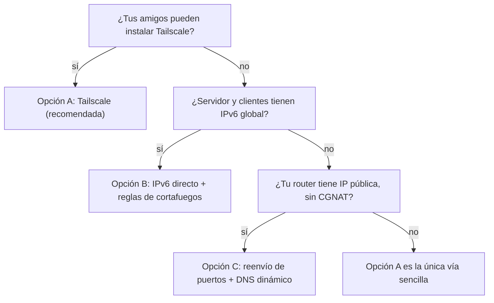
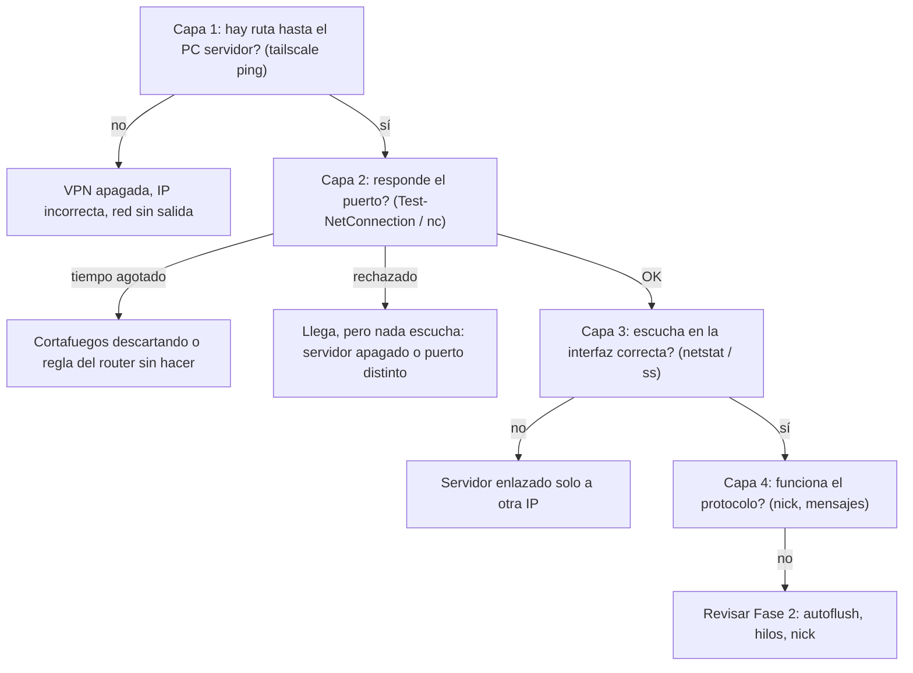

# Fase 3 — Chat entre PCs en redes distintas

> Proyecto **Chat-Application** (Java, sockets, JavaFX).
> Objetivo de esta fase: **que el servidor corra en un PC y los clientes se conecten desde otros PCs que están en redes diferentes** (otra casa, otro operador, datos móviles...), usando el código de la Fase 2 con los cambios mínimos.

## Índice

1. Objetivo y alcance
2. El problema real: por qué `127.0.0.1` no basta y por qué Internet no te deja entrar
3. Opciones comparadas y recomendación
4. Cambios en el código (mínimos)
5. Plan de trabajo por pasos
6. Opción A: Tailscale, paso a paso
7. Opción B: IPv6 directo, paso a paso
8. Opción C: reenvío de puertos IPv4 (la menos recomendable)
9. Cortafuegos del sistema operativo
10. Diagnóstico por capas
11. Seguridad: lo que esta fase NO resuelve
12. Redes reales: desconexiones, inactividad y reconexión
13. Mejoras opcionales
14. Qué prepara esta fase para la Fase 4
15. Glosario
16. Preguntas de repaso (con respuestas)
17. Fuentes consultadas

---

## 1. Objetivo y alcance

### Qué se consigue

| Antes (Fase 2) | Después (Fase 3) |
|---|---|
| Servidor y clientes en el **mismo PC** | Servidor en un PC y clientes en **otros PCs** |
| El cliente usa siempre `127.0.0.1` | El cliente recibe la **IP del servidor** como dato de entrada |
| Todo ocurre dentro de la misma máquina | Los mensajes cruzan **redes distintas** (Internet de por medio) |

### Qué NO cambia

La mayor parte del trabajo de esta fase **no es código**, es **red**. La lógica del chat (hilos, `ClientHandler`, `broadcast`, protocolo del nick) **se queda exactamente igual**. Eso es una buena señal de diseño: la capa de aplicación no sabe ni le importa por dónde viajan los bytes.

### Qué queda fuera de alcance

La **wifi común privada** (todos en la misma red local) queda fuera del objetivo de la fase, porque no obliga a resolver el problema de las redes distintas. Eso sí: es una **herramienta de diagnóstico muy útil** (apartado 5, paso 3.1): si el chat funciona en una LAN pero no por Internet, ya sabes que el fallo está en la red y no en tu código.

---

## 2. El problema real: por qué `127.0.0.1` no basta y por qué Internet no te deja entrar

### 2.1 Tipos de dirección

Un mismo PC puede tener varias direcciones a la vez, y **no todas sirven desde cualquier sitio**:

| Tipo | Ejemplo | ¿Alcanzable desde otra red? | Notas |
|---|---|---|---|
| **Loopback** | `127.0.0.1`, `::1` | **No** | Solo la propia máquina |
| **IP privada de LAN** | `192.168.1.20`, `10.0.0.5`, `172.16.x.x` | **No** | Solo dentro de la misma red local. Se repiten en millones de casas |
| **IP compartida (100.64.0.0/10)** | `100.101.102.103` | Solo **dentro de una VPN** que use ese rango | Tailscale asigna direcciones de este rango a tus dispositivos |
| **IP pública IPv4** | `85.x.x.x` | Sí, **si** hay reenvío de puertos y no hay CGNAT | La que ve Internet de tu casa |
| **IPv6 global** | `2a0c:...`, `2001:...` | Sí, **si** el router permite la entrada | Direcciones públicas, sin NAT |
| **IPv6 de enlace local** | `fe80::...` | **No** | Solo en el mismo enlace; exige indicar interfaz (`%eth0`). No la uses |

### 2.2 Por qué desde otra red no puedes conectar a tu IP privada

Tu servidor tiene una IP como `192.168.1.20`. Un amigo en otra casa **también** tiene redes con direcciones como `192.168.1.x`. Esas direcciones no son únicas en el mundo, así que **no se enrutan por Internet**: no significan nada fuera de tu red local.

### 2.3 Por qué Internet no te deja entrar aunque tengas la IP pública

Entre Internet y tu PC hay tres obstáculos posibles. Cada opción de la fase 3 esquiva alguno de ellos:

| Obstáculo | Qué es | Cómo se esquiva |
|---|---|---|
| **NAT del router** | Tu router comparte **una** IP pública entre todos los aparatos de casa. Solo deja pasar el tráfico que **tú iniciaste** hacia fuera; lo que llega sin pedirlo se descarta | Reenvío de puertos (IPv4), o una VPN, o IPv6 |
| **CGNAT** | Tu operador comparte una misma IP pública entre **muchos clientes**. Entonces ni siquiera tu router tiene IP pública propia y el reenvío de puertos **no sirve** | VPN (Tailscale), o IPv6 |
| **Cortafuegos** | Router y sistema operativo bloquean por defecto la entrada | Reglas de permitir en ambos |

Cómo saber si estás detrás de **CGNAT**: mira la IP "WAN" que muestra tu router y compárala con la que ves en cualquier web de "cuál es mi IP". Si son **distintas**, o la del router está en el rango `100.64.0.0/10` o es privada, estás detrás de CGNAT. (Si tienes dudas, el reenvío de puertos IPv4 no es tu camino.)

### 2.4 Dos cosas del servidor que ya juegan a tu favor

- `new ServerSocket(PORT)` **escucha en todas las interfaces** (la dirección "comodín"), no solo en `127.0.0.1`. Por eso el servidor de la Fase 2 ya acepta conexiones por la IP de la LAN, la de la VPN o la de IPv6 **sin tocar nada**.
- El servidor imprime `socket.getInetAddress()` al conectarse alguien. En esta fase ese dato pasa a ser **muy útil**: te enseña desde qué IP real está conectando cada cliente.

---

## 3. Opciones comparadas y recomendación

### 3.1 Comparativa

| | **A. Tailscale (VPN)** | **B. IPv6 directo** | **C. Reenvío de puertos IPv4** | **D. LAN común** |
|---|---|---|---|---|
| Qué necesitas | App + cuenta en **todos** los PCs | IPv6 en **ambos extremos** + reglas de cortafuegos | IP pública (sin CGNAT) + regla en el router + DNS dinámico | Estar en la misma wifi |
| ¿Funciona con CGNAT? | **Sí** | **Sí** (IPv6 no usa NAT) | **No** | — |
| ¿Configurar el router? | **No** | Sí (regla de entrada IPv6) | Sí (reenvío de puertos) | No |
| ¿Instalar algo en los clientes? | Sí | No | No | No |
| Seguridad | Tráfico **cifrado** y acceso solo para quien invites | **Expuesto a todo Internet**, sin cifrar | **Expuesto a todo Internet**, sin cifrar | Solo la red local |
| Dificultad | Baja | Media-alta | Media | Muy baja |
| Coste | Gratis (plan Personal) | Gratis | Gratis | Gratis |
| ¿Sirve como objetivo de la fase? | **Sí** | **Sí** (con condiciones) | Sí, pero no recomendable | **No** (solo diagnóstico) |

### 3.2 Qué elegir



**Recomendación:** empieza por **Tailscale**. Es lo que menos código y menos riesgo necesita:

1. Atraviesa NAT y CGNAT sin tocar el router.
2. Cifra el tráfico (tu chat va en texto plano, y así queda protegido en el trayecto).
3. Solo pueden conectar los dispositivos que tú autorices.
4. Es el único que funciona igual de bien desde cualquier red del mundo.

**IPv6** es una segunda opción interesante **para aprender** cómo funciona Internet sin NAT, pero tiene condiciones que no controlas (que ambos extremos tengan IPv6 y que el router permita la entrada). **Reenvío de puertos** déjalo para el final y solo si entiendes los riesgos (apartado 11).

### 3.3 Otras alternativas que existen (no desarrolladas en este documento)

Hay más VPN "de malla" parecidas a Tailscale (por ejemplo ZeroTier), la posibilidad de montar tu propia VPN con WireGuard, o usar un servidor barato en la nube como punto de encuentro. No he verificado sus condiciones actuales (límites, precios), así que consulta su documentación antes de elegir. La lógica de esta fase sirve igual con cualquiera: lo único que cambia es **qué dirección IP** pones en el cliente.

---

## 4. Cambios en el código (mínimos)

### 4.1 Resumen de cambios

| Archivo | ¿Cambia? | Qué |
|---|---|---|
| `ClientHandler.java` | **No** | Nada |
| `Server.java` | **Opcional** | Mostrar al arrancar las direcciones por las que se puede llegar (muy recomendado) |
| `NetworkClient.java` | **Sí** | La IP y el puerto dejan de ser fijos; tiempo máximo de conexión; mensajes de error distintos según el fallo |

### 4.2 `NetworkClient.java` (versión de la Fase 3)

Cambios respecto a la Fase 2:

1. **IP y puerto como datos de entrada**: se leen de los argumentos del programa y, si no se pasan, se **preguntan por teclado** (en VS Code es más cómodo que configurar argumentos).
2. **Conexión con límite de tiempo**: en una red real, conectar a una IP que no responde puede dejar al programa esperando mucho tiempo. Se usa `connect(dirección, timeout)`.
3. **Mensajes de error distintos**: *tiempo agotado*, *conexión rechazada* y *nombre desconocido* significan cosas diferentes (apartado 10).
4. El `Scanner` pasa a crearse **antes** del `try`, porque hace falta para preguntar la IP.

```java
package com.mycompany.chat.client;

import java.io.BufferedReader;
import java.io.IOException;
import java.io.InputStreamReader;
import java.io.PrintWriter;
import java.net.ConnectException;
import java.net.InetSocketAddress;
import java.net.Socket;
import java.net.SocketTimeoutException;
import java.net.UnknownHostException;
import java.nio.charset.StandardCharsets;
import java.util.Scanner;

public class NetworkClient {

    private static final String IP_POR_DEFECTO = "127.0.0.1";
    private static final int PUERTO_POR_DEFECTO = 5000;
    private static final int TIMEOUT_CONEXION_MS = 5000;

    public static void main(String[] args) {
        Scanner teclado = new Scanner(System.in);

        // 1) IP: argumento 0, o se pregunta por teclado.
        String ipServidor = args.length > 0 ? args[0] : preguntarIp(teclado);

        // 2) Puerto: argumento 1, o el de por defecto.
        int puertoServidor = PUERTO_POR_DEFECTO;
        if (args.length > 1) {
            try {
                puertoServidor = Integer.parseInt(args[1]);
            } catch (NumberFormatException e) {
                System.err.println("Puerto no valido: " + args[1]);
                return;
            }
        }

        try (Socket socket = conectar(ipServidor, puertoServidor, TIMEOUT_CONEXION_MS);
             BufferedReader reader = new BufferedReader(
                     new InputStreamReader(socket.getInputStream(), StandardCharsets.UTF_8));
             PrintWriter writer = new PrintWriter(
                     socket.getOutputStream(), true, StandardCharsets.UTF_8)) {

            System.out.println("Conectado a " + ipServidor + ":" + puertoServidor);

            System.out.print("Escribe tu username: ");
            String nombre = teclado.nextLine();
            writer.println(nombre);

            Thread hiloEscucha = new Thread(new Escuchador(reader, socket));
            hiloEscucha.setDaemon(true);
            hiloEscucha.start();

            while (teclado.hasNextLine()) {
                String mensaje = teclado.nextLine();
                if ("/salir".equalsIgnoreCase(mensaje)) {
                    break;
                }
                writer.println(mensaje);
            }

        } catch (SocketTimeoutException e) {
            // Los paquetes se pierden por el camino: cortafuegos que descarta, IP incorrecta, sin ruta...
            System.err.println("Tiempo agotado conectando a " + ipServidor + ":" + puertoServidor);
            System.err.println("  Nadie contesta: revisa la IP, la VPN y el cortafuegos del servidor.");
        } catch (ConnectException e) {
            // El paquete LLEGO a la maquina, pero nada escucha en ese puerto (o lo rechaza).
            System.err.println("Conexion rechazada por " + ipServidor + ":" + puertoServidor);
            System.err.println("  Esta el servidor arrancado y escuchando en ese puerto?");
        } catch (UnknownHostException e) {
            System.err.println("No se reconoce el servidor: " + ipServidor);
        } catch (IOException e) {
            System.err.println("Error de conexion: " + e.getMessage());
        }
    }

    private static String preguntarIp(Scanner teclado) {
        System.out.print("IP o nombre del servidor [" + IP_POR_DEFECTO + "]: ");
        String texto = teclado.nextLine().trim();
        return texto.isEmpty() ? IP_POR_DEFECTO : texto;
    }

    // Crea el socket SIN conectar, y conecta con un limite de tiempo.
    // Si falla, cierra el socket antes de propagar el error (para no dejarlo abierto).
    private static Socket conectar(String ip, int puerto, int timeoutMs) throws IOException {
        Socket socket = new Socket();
        try {
            socket.connect(new InetSocketAddress(ip, puerto), timeoutMs);
            return socket;
        } catch (IOException e) {
            socket.close();
            throw e;
        }
    }

    // La clase Escuchador no cambia respecto a la Fase 2.
    static class Escuchador implements Runnable {

        private final BufferedReader reader;
        private final Socket socket;

        Escuchador(BufferedReader reader, Socket socket) {
            this.reader = reader;
            this.socket = socket;
        }

        @Override
        public void run() {
            try {
                String linea;
                while ((linea = reader.readLine()) != null) {
                    System.out.println(linea);
                }
                System.out.println("El servidor cerro la conexion.");
            } catch (IOException e) {
                if (!socket.isClosed()) {
                    System.err.println("Se perdio la conexion: " + e.getMessage());
                }
            }
        }
    }
}
```

#### Explicación de los cambios

| Línea o bloque | Qué hace y por qué |
|---|---|
| `Scanner teclado = new Scanner(System.in);` antes del `try` | Hace falta para preguntar la IP **antes** de conectar. Ya no está en el `try-with-resources`: no pasa nada, porque el programa termina al salir |
| `args.length > 0 ? args[0] : preguntarIp(teclado)` | Operador ternario: "si hay argumento úsalo, si no pregunta". Permite ejecutar desde terminal con `NetworkClient 100.101.102.103` o desde VS Code sin argumentos |
| `Integer.parseInt(args[1])` con `try/catch` | Convierte el texto del puerto a número. Si alguien escribe `abc`, lanza `NumberFormatException` y se avisa en vez de romper |
| `new Socket()` **sin parámetros** | Crea el socket **sin conectar**. Con `new Socket(ip, puerto)` la conexión se intenta al crearlo y no se puede poner un límite de tiempo |
| `socket.connect(new InetSocketAddress(ip, puerto), timeoutMs)` | Conecta esperando como máximo `timeoutMs` milisegundos. Si no, lanza `SocketTimeoutException` |
| `catch (IOException e) { socket.close(); throw e; }` | Si la conexión falla, el socket ya estaba creado: se cierra antes de propagar el error. Es el mismo patrón que `cerrarSocketIndividual` del servidor |
| Varios `catch` | Cada subtipo de `IOException` se captura **antes** que el general `IOException`; si no, el general los taparía a todos |

> **IPv6 en el cliente:** si usas direcciones IPv6, escríbelas **sin corchetes** (por ejemplo `2a0c:xxxx:xxxx::1`). `InetSocketAddress(String, int)` las acepta tal cual; los corchetes solo se usan en las URL. No uses direcciones `fe80::` (enlace local).

### 4.3 `Server.java`: mostrar por dónde se puede llegar (opcional, recomendado)

El servidor escucha en todas las interfaces, pero tú necesitas saber **qué IP darle a tus amigos**. Este método imprime las direcciones del PC al arrancar.

Añade estos imports:

```java
import java.net.Inet4Address;
import java.net.InetAddress;
import java.net.NetworkInterface;
import java.net.SocketException;
import java.util.Collections;
```

Añade este método a la clase `Server`:

```java
    // Muestra las direcciones por las que se puede llegar a este servidor.
    private void mostrarDirecciones() {
        System.out.println("Direcciones de este PC (da la adecuada a tus clientes):");
        try {
            for (NetworkInterface interfaz : Collections.list(NetworkInterface.getNetworkInterfaces())) {
                // Ignoramos interfaces apagadas y la de loopback (127.0.0.1)
                if (!interfaz.isUp() || interfaz.isLoopback()) {
                    continue;
                }
                for (InetAddress direccion : Collections.list(interfaz.getInetAddresses())) {
                    // Ignoramos las de enlace local (fe80:: y 169.254.x.x): no sirven para conectar
                    if (direccion.isLinkLocalAddress()) {
                        continue;
                    }
                    String etiqueta = esRangoTailscale(direccion) ? "  <-- parece una IP de Tailscale" : "";
                    System.out.println("  " + direccion.getHostAddress()
                            + "  (" + interfaz.getDisplayName() + ")" + etiqueta);
                }
            }
        } catch (SocketException e) {
            System.err.println("No se pudieron listar las interfaces de red: " + e.getMessage());
        }
    }

    // Rango 100.64.0.0/10: primer byte 100 y los 2 bits altos del segundo byte son "01".
    private static boolean esRangoTailscale(InetAddress direccion) {
        if (!(direccion instanceof Inet4Address)) {
            return false;
        }
        byte[] b = direccion.getAddress();
        return (b[0] & 0xFF) == 100 && (b[1] & 0xC0) == 0x40;
    }
```

Y llámalo al principio de `iniciar()`, justo después del `println` de "Servidor escuchando...":

```java
            System.out.println("Servidor escuchando en el puerto " + PORT);
            mostrarDirecciones();
```

| Detalle | Explicación |
|---|---|
| `Collections.list(...)` | Convierte la `Enumeration` antigua que devuelve Java en una lista que se puede recorrer con `for-each` |
| `isLinkLocalAddress()` | Descarta `fe80::...` y `169.254.x.x`, que no sirven para conectar desde otro PC |
| `(b[0] & 0xFF)` | En Java los `byte` tienen **signo** (van de -128 a 127). `& 0xFF` lo convierte a un número de 0 a 255 para poder compararlo |
| `(b[1] & 0xC0) == 0x40` | Comprueba que el segundo byte esté entre 64 y 127, que es lo que define el rango `100.64.0.0/10` |

### 4.4 Endurecimiento opcional: escuchar **solo** en la IP de la VPN

Por defecto el servidor acepta conexiones por **cualquier** interfaz. Si solo quieres que entren por la VPN, puedes enlazar el `ServerSocket` a una dirección concreta:

```java
// En vez de: new ServerSocket(PORT)
InetAddress direccionVpn = InetAddress.getByName("100.101.102.103"); // la IP de Tailscale de ESTE PC
try (ServerSocket serverSocket = new ServerSocket(PORT, 50, direccionVpn)) {
```

Así, aunque un router o un cortafuegos dejara pasar el puerto desde la LAN o desde Internet, **el servidor no estaría escuchando ahí**. El segundo parámetro (`50`) es el tamaño de la cola de conexiones pendientes.

Contras: tendrías que pasar esa IP como dato de entrada (no la escribas fija en el código) y `ServerSocket` fallará al arrancar si esa dirección no está asignada a ninguna interfaz del PC (por ejemplo, si Tailscale está apagado).

---

## 5. Plan de trabajo por pasos

Avanza en este orden. **No pases al siguiente paso hasta que el anterior funcione**: así, si algo falla, sabes exactamente en qué capa está el problema.

| Paso | Qué haces | Qué demuestra |
|---|---|---|
| **3.0** | Aplica los cambios del apartado 4 y compila (`mvn compile`). Prueba con **2 clientes en el mismo PC**, usando `127.0.0.1` | Que tus cambios no han roto la Fase 2 |
| **3.1** *(diagnóstico, opcional)* | Dos PCs en la **misma wifi**. El cliente usa la IP de LAN del servidor (la muestra `mostrarDirecciones()`) | Que el servidor acepta conexiones por una IP distinta de loopback y que el cortafuegos del servidor deja pasar el puerto |
| **3.2** | En el **mismo PC**, conecta el cliente a la IP de Tailscale (o de LAN) **del propio servidor** en vez de a `127.0.0.1` | Que el servidor realmente escucha en todas las interfaces |
| **3.3** | Instala Tailscale en **dos aparatos tuyos** con **la misma cuenta**, en redes distintas (por ejemplo, un portátil conectado a los datos del móvil). Servidor en uno, cliente en el otro | **El objetivo de la fase**, sin depender todavía de nadie más |
| **3.4** | Un amigo en su casa: compartirle el dispositivo del servidor o invitarle a tu red de Tailscale | Que funciona con otra persona y otro operador |
| **3.5** *(opcional)* | Probar la opción IPv6 (apartado 7) y, si procede, el reenvío de puertos (apartado 8) | Cómo funciona Internet sin VPN |

> **Truco del paso 3.3:** si no tienes un segundo PC en otra red, un portátil conectado a la **conexión compartida de datos del móvil** ya está en una red distinta a la de tu casa.

---

## 6. Opción A: Tailscale, paso a paso

### 6.1 Qué es y cómo funciona

Tailscale crea una **red privada virtual** entre tus dispositivos. Cada dispositivo con la app instalada recibe una **IP propia del rango `100.64.0.0/10`**. Entre esos dispositivos los paquetes viajan cifrados, y no hace falta abrir puertos en el router ni saber nada de NAT.

Lo importante para tu chat:

- Para el servidor, un cliente de Tailscale es una conexión TCP normal: **tu código no sabe que hay una VPN en medio**.
- Si los dos dispositivos pueden verse directamente, el tráfico va **directo**. Si no (algunas redes lo impiden), Tailscale usa un **servidor de retransmisión** y el tráfico sigue cifrado. El chat funcionará en ambos casos, solo que el segundo es algo más lento.
- Por eso funciona **aunque estés detrás de CGNAT**.

### 6.2 Coste

Según la página de precios de Tailscale, el plan **Personal** es gratuito, de uso no comercial, e incluye hasta **6 usuarios** y **dispositivos de usuario ilimitados**. Los planes cambian con el tiempo (en abril de 2026 hubo una reorganización), así que **comprueba la página de precios** antes de apoyarte en un límite concreto.

### 6.3 Preparar el PC del servidor

1. Instala Tailscale desde su página oficial de descargas y **inicia sesión** (con una cuenta de Google, Microsoft, GitHub, etc.).
2. Comprueba que está conectado:
   ```
   tailscale status
   ```
3. Averigua la IP de Tailscale de este PC:
   ```
   tailscale ip -4
   ```
   Será algo como `100.101.102.103`.
4. Abre el puerto en el cortafuegos (apartado 9).
5. Arranca el servidor. Con el método `mostrarDirecciones()` del apartado 4.3 verás esa IP marcada como *"parece una IP de Tailscale"*.

### 6.4 Paso 3.3: tus dos dispositivos con la misma cuenta

1. Instala Tailscale en el segundo dispositivo e inicia sesión **con la misma cuenta**.
2. Los dos dispositivos aparecen automáticamente en la misma red (llamada *tailnet*).
3. En el segundo, ejecuta `NetworkClient` e introduce la IP de Tailscale del servidor.

### 6.5 Paso 3.4: dar acceso a un amigo

Hay dos formas:

| | **Compartir el dispositivo** | **Invitar al usuario a tu tailnet** |
|---|---|---|
| Qué ve el amigo | **Solo** el PC del servidor | **Todos** los dispositivos de tu red (se puede limitar con reglas de acceso) |
| Qué cuenta necesita | **Su propia** cuenta de Tailscale (su propia red) | Se une a **tu** red |
| ¿Cuenta como usuario tuyo? | No | Sí (cuenta en el límite de usuarios del plan) |
| Cuándo conviene | Compartir un dispositivo concreto con gente de confianza | Colaborar de forma más amplia |

**Recomendación: compartir solo el dispositivo del servidor.** Es el principio de *mínimo privilegio*: tu amigo no necesita ver nada más.

Pasos para compartir (los ejecutas tú, como propietario o administrador de tu red):

1. Abre la consola de administración de Tailscale → sección **Machines**.
2. Elige el PC del servidor → **Share**.
3. Indica el correo de tu amigo, o genera un enlace de invitación.
4. Tu amigo instala Tailscale, inicia sesión con **su** cuenta y **acepta** la invitación.
5. El dispositivo aparece en su Tailscale. Tu amigo debe usar la IP que **él** vea para ese dispositivo (se ve con `tailscale status` o en su app).

Detalles que conviene saber:

- Las invitaciones sin usar **caducan a los 30 días**.
- Un dispositivo compartido queda en **cuarentena**: solo puede **responder** a conexiones entrantes, no iniciar conexiones salientes. Para un servidor de chat, que solo recibe conexiones, es justo lo que necesitas.
- Si revocas la invitación, tu amigo pierde el acceso al instante.

### 6.6 Comprobar que todo funciona (desde el cliente)

```
tailscale status
tailscale ping 100.101.102.103
```

`tailscale ping` te dice si la conexión es **directa** o **a través de un servidor de retransmisión**. Ambas sirven. Después prueba el puerto del chat:

| Sistema | Comando |
|---|---|
| Windows (PowerShell) | `Test-NetConnection -ComputerName 100.101.102.103 -Port 5000` |
| Linux / macOS | `nc -vz 100.101.102.103 5000` |

Si `TcpTestSucceeded` aparece en `True` (o `nc` dice "succeeded"), ya puedes lanzar `NetworkClient`.

### 6.7 Qué tiene que estar encendido

- Tailscale tiene que estar **activo en ambos dispositivos** (servidor y cliente).
- El **PC del servidor tiene que estar encendido, despierto y con `Server` ejecutándose**. Si el PC entra en suspensión, nadie podrá conectar.
- Si vas a usar el servidor a menudo, desactiva la suspensión automática mientras lo uses.

---

## 7. Opción B: IPv6 directo, paso a paso

### 7.1 Qué cambia respecto a IPv4

En IPv4 se hace **reenvío de puertos** porque el router comparte una IP entre todos los aparatos (NAT). En IPv6 típico **no hay NAT**: tu PC puede tener una dirección pública propia. Entonces, "abrir el puerto" se reduce a una **regla de cortafuegos que permita la entrada** hacia ese PC y ese puerto.

```
IPv4  →  reenvío de puertos
IPv6  →  regla de permitir en el cortafuegos
```

### 7.2 Requisitos (los dos extremos)

| Quién | Necesita |
|---|---|
| **Servidor** | Que su operador le dé IPv6 y que el router lo tenga activado; que el PC tenga una dirección IPv6 **global** |
| **Cliente** | Que su conexión también tenga IPv6 (hogar, datos móviles o universidad: **no todas lo tienen**) |

**Cómo comprobarlo:**

- En Windows, `ipconfig` muestra una "Dirección IPv6". Una dirección **global** empieza por `2` o por `3` (las `fe80::` **no** sirven, son de enlace local).
- Para comprobar que sales a Internet por IPv6, prueba `curl -6 https://ifconfig.me` o cualquier web de test de IPv6. Si da error, ese extremo **no** tiene IPv6.

### 7.3 Elegir la dirección correcta (el punto más delicado)

Un PC con IPv6 suele tener **varias direcciones a la vez**. Las "temporales" (extensiones de privacidad) **cambian con el tiempo** y se usan para navegar; las estables se usan para recibir conexiones.

| Dirección | Para qué sirve | ¿La usas para el servidor? |
|---|---|---|
| **Temporal** (ipconfig la marca como "Dirección IPv6 temporal") | Salida a Internet; cambia | **No** |
| **Estable** (sin la etiqueta "temporal") | Recibir conexiones | **Sí** |

Además, el **prefijo** que te da tu operador puede cambiar con el tiempo (prefijo dinámico). Si cambia, **tu dirección cambia** y tus amigos tienen que usar la nueva. Es el mismo problema que tener una IP pública IPv4 dinámica; se resolvería con un servicio de DNS dinámico, que no está cubierto aquí.

### 7.4 Regla de entrada en el router

Cada router lo llama de una manera (*cortafuegos IPv6*, *pinhole*, *reglas de entrada*...), y la interfaz varía mucho de unos a otros, así que no puedo darte pasos exactos. La regla debe decir:

| Campo | Valor |
|---|---|
| Protocolo | TCP |
| Puerto | 5000 |
| Destino | La **dirección IPv6 estable** del PC del servidor |
| Acción | Permitir |

Si el router solo deja elegir el dispositivo (no la dirección), ten en cuenta que puede abrir el puerto a una dirección temporal que cambiará, y la regla dejará de funcionar.

### 7.5 Cortafuegos del PC

Crea la regla de entrada en el cortafuegos del sistema operativo (apartado 9). En este caso la dirección remota es **cualquiera**, porque no sabes desde dónde conectarán tus amigos.

### 7.6 Cliente

En `NetworkClient`, escribe la dirección IPv6 **sin corchetes**. Comprueba antes el puerto:

```
Test-NetConnection -ComputerName 2a0c:xxxx:xxxx::1 -Port 5000
```

### 7.7 Java y IPv6

- `new ServerSocket(PORT)` en un sistema con IPv6 activo escucha en las dos pilas (IPv4 e IPv6) a la vez. En `netstat` debería verse como `[::]:5000`.
- **No** uses la opción `-Djava.net.preferIPv4Stack=true`: desactivaría IPv6 en Java.

### 7.8 Ventajas e inconvenientes

| Ventajas | Inconvenientes |
|---|---|
| No necesita instalar nada en los clientes | Depende de que **ambos** extremos tengan IPv6 |
| No hay NAT: es una conexión directa | La dirección del servidor puede cambiar |
| Sirve para entender cómo funciona Internet sin NAT | **Expone el servidor a todo Internet**, sin cifrado ni autenticación (apartado 11) |

---

## 8. Opción C: reenvío de puertos IPv4 (la menos recomendable)

Solo tiene sentido si **no hay CGNAT** (apartado 2.3).

1. **Reserva una IP de LAN fija** para el PC del servidor en el router (reserva DHCP), para que la regla no apunte a una IP que cambie.
2. En el router, crea la regla de **reenvío de puertos**: TCP, puerto externo `5000` → IP de LAN del servidor, puerto interno `5000`.
3. Abre el puerto en el cortafuegos del PC (apartado 9).
4. Tus amigos conectan a tu **IP pública**. Normalmente cambia de vez en cuando, así que haría falta un servicio de **DNS dinámico**.
5. **Pruébalo desde fuera** (por ejemplo, desde los datos del móvil). Desde dentro de tu propia red, usar tu IP pública a menudo **no funciona** en muchos routers, aunque la regla esté bien.

Por qué la dejo para el final: abres un puerto de tu casa a **todo Internet** con un servidor sin autenticación ni cifrado (apartado 11).

---

## 9. Cortafuegos del sistema operativo

El cortafuegos del **PC del servidor** debe permitir conexiones **entrantes** al puerto TCP 5000. Cuando ejecutas Java por primera vez en Windows puede aparecer una ventana pidiendo permiso: ahí es donde se decide a qué tipos de red se aplica.

### 9.1 Windows

El detalle que más problemas da: Windows aplica reglas distintas según el **perfil de red** (*Privada*, *Pública*, *Dominio*). Si la regla solo cubre "Privada" y la red de la VPN está clasificada como "Pública", **el tráfico se bloquea**. Usuarios de Tailscale han reportado exactamente este problema, y se arregla con una regla que cubra todos los perfiles.

Crea la regla desde una terminal **como administrador**.

**Para Tailscale** (solo acepta conexiones desde el rango de Tailscale):

```
netsh advfirewall firewall add rule name="Chat TCP 5000 Tailscale" dir=in action=allow protocol=TCP localport=5000 profile=any remoteip=100.64.0.0/10
```

**Para IPv6 directo o reenvío de puertos** (acepta de cualquier origen: más riesgo):

```
netsh advfirewall firewall add rule name="Chat TCP 5000 abierto" dir=in action=allow protocol=TCP localport=5000 profile=any
```

**Para quitar una regla** cuando termines de probar:

```
netsh advfirewall firewall delete rule name="Chat TCP 5000 Tailscale"
```

Para ver en qué perfil está una red: `Get-NetConnectionProfile` (PowerShell).

### 9.2 Linux

Con `ufw`:

```
sudo ufw allow in on tailscale0 to any port 5000 proto tcp
sudo ufw status
```

(`tailscale0` es el nombre habitual de la interfaz de Tailscale en Linux.)

### 9.3 macOS

El cortafuegos de aplicación suele preguntar la primera vez que Java intenta aceptar conexiones entrantes. Responde **Permitir**.

### 9.4 Antivirus con cortafuegos propio

Algunos antivirus incluyen su propio cortafuegos que **sustituye** al de Windows y puede bloquear el tráfico aunque la regla de Windows esté bien. Si todo lo demás está correcto y sigue sin funcionar, desactívalo **un momento** para comprobarlo y, si era el culpable, crea la regla ahí.

---

## 10. Diagnóstico por capas

Cuando algo no funciona, **no toques el código**. Comprueba las capas **de abajo hacia arriba**:



### 10.1 Los comandos de cada capa

| Capa | Qué comprobar | Windows | Linux / macOS |
|---|---|---|---|
| 1. Ruta | Que el otro extremo es alcanzable | `tailscale ping <ip>` | `tailscale ping <ip>` |
| 2. Puerto | Que el puerto contesta | `Test-NetConnection <ip> -Port 5000` | `nc -vz <ip> 5000` |
| 3. Escucha | Que el servidor escucha en las interfaces correctas | `netstat -ano \| findstr :5000` | `ss -ltnp \| grep 5000` |
| 4. Aplicación | Que el chat funciona | Ejecutar `NetworkClient` | Ejecutar `NetworkClient` |

En la capa 3 debe aparecer una línea **LISTENING** con `0.0.0.0:5000` o `[::]:5000` (todas las interfaces). Si aparece solo `127.0.0.1:5000`, el servidor solo escucha en local.

> `ping` normal (ICMP) puede estar **bloqueado** por el cortafuegos aunque el TCP funcione. Un `ping` fallido **no prueba** que no haya conexión; fíate más de la comprobación del puerto TCP.

### 10.2 Qué significa cada mensaje de error del cliente

| Mensaje del cliente | Qué significa realmente | Qué mirar |
|---|---|---|
| **Tiempo agotado** | Los paquetes **se pierden por el camino**: nadie responde | IP equivocada, VPN apagada, cortafuegos que **descarta**, regla del router sin hacer |
| **Conexión rechazada** | El paquete **sí llega** a la máquina, pero **no hay nada escuchando** en ese puerto (o lo rechazan activamente) | El servidor no está arrancado, puerto distinto, servidor enlazado a otra IP |
| **No se reconoce el servidor** | El nombre no se puede traducir a una IP | Error al escribir el nombre; usa la IP directamente |
| Conecta, pide el nombre y **no llega nada** | Es un fallo de **aplicación**, no de red | Autoflush del `PrintWriter`, hilo `Escuchador` (Fase 2) |

La diferencia entre **tiempo agotado** y **rechazado** es la pista más útil de toda la fase.

### 10.3 Síntomas frecuentes

| Síntoma | Causa probable |
|---|---|
| Funciona en la misma wifi pero no por Internet | NAT, CGNAT, cortafuegos o VPN sin configurar |
| `tailscale ping` funciona pero `Test-NetConnection` falla | El cortafuegos del **PC servidor** bloquea el puerto (perfil de red o antivirus) |
| `tailscale ping` dice que va por un servidor de retransmisión | No es un error: funcionará, solo algo más lento |
| Funciona unos minutos y luego se corta | Inactividad: ver apartado 12 |
| Desde tu propia red no puedes entrar con tu IP pública | Típico del reenvío de puertos; pruébalo desde fuera |
| El servidor deja de aceptar clientes tras reiniciar el PC | Tailscale no se ha iniciado, o la IP del servidor es otra |

---

## 11. Seguridad: lo que esta fase NO resuelve

### 11.1 Qué protege cada opción

| | Cifra el tráfico | Limita quién puede conectar | Expone el puerto a Internet |
|---|---|---|---|
| **Tailscale** | Sí (entre los dispositivos de la red) | Sí: solo quien tú invites o compartas | No |
| **IPv6 directo** | **No** | **No** | **Sí** |
| **Reenvío de puertos IPv4** | **No** | **No** | **Sí** |

### 11.2 Lo que el servidor actual no tiene, vayas por donde vayas

| Carencia | Consecuencia |
|---|---|
| **Sin autenticación** | Cualquiera que llegue al puerto puede entrar con cualquier nombre |
| **Texto plano** | Cualquiera que pueda ver el tráfico lee los mensajes (con Tailscale, queda cubierto en el trayecto) |
| **Nombres sin validar ni únicos** | Alguien puede hacerse pasar por otro usuario |
| **Sin límite de tamaño de línea** | `readLine()` acumula en memoria todo lo que llegue hasta el salto de línea; alguien podría enviar una línea gigante |
| **Sin límite de conexiones** | Un hilo por cliente: miles de conexiones agotarían los recursos |

> **Conclusión práctica:** con **Tailscale** y gente de confianza, el servidor actual es razonable para aprender. **No lo expongas directamente a Internet** (IPv6 abierto o reenvío de puertos) sin añadir, como mínimo, autenticación y límites.

### 11.3 Medidas mínimas, de más sencilla a más ambiciosa

| Medida | Dificultad | Qué aporta |
|---|---|---|
| Regla de cortafuegos limitada a `100.64.0.0/10` (apartado 9) | Muy baja | Solo acepta conexiones desde la VPN |
| Enlazar el servidor a la IP de la VPN (apartado 4.4) | Baja | El servidor ni siquiera escucha fuera de la VPN |
| Validar el nombre (longitud máxima, sin espacios raros) y rechazar duplicados | Baja | Evita suplantaciones simples |
| Contraseña compartida como segunda línea del protocolo | Media | Autenticación básica |
| Límite de tamaño de línea y de número de clientes | Media | Protege contra abusos |
| Cifrado de la aplicación con TLS (`SSLServerSocket`) | Alta | Cifrado propio, necesario si se expone a Internet |

---

## 12. Redes reales: desconexiones, inactividad y reconexión

En tu PC todo era instantáneo y fiable. En redes reales aparecen problemas nuevos:

### 12.1 Caídas sin aviso

Cuando un cliente se va con `/salir` o cierra bien el programa, el servidor recibe `null` en `readLine()` y limpia. Pero si el cliente **se queda sin red, se apaga el Wi-Fi, se suspende el portátil o se cae la VPN**, no se envía ningún aviso de cierre. Para el servidor el cliente sigue "conectado" y su `readLine()` **sigue esperando**. Mientras tanto:

- El handler sigue en la lista (un "fantasma").
- Los `broadcast` siguen escribiendo en un socket que no llega a nadie.
- El sistema operativo acaba detectando la caída por sus propios temporizadores, que suelen ser **de minutos a horas** según el sistema.

### 12.2 Inactividad

Algunos routers y cortafuegos olvidan una conexión que lleva mucho tiempo sin tráfico. Si en tu chat nadie escribe durante un rato largo, puede que la conexión deje de funcionar sin avisar. Esto depende de cada red, y no he podido comprobar cuánto tarda en la tuya.

### 12.3 Un cliente lento puede frenar a todos

`enviar` escribe en el socket de forma **bloqueante**. Si el destino no consume lo que le llega (red muy lenta o cliente colgado), el búfer de envío se llena y `writer.println(...)` **se queda esperando**. Como el hilo que ejecuta `broadcast` es el del emisor, **ese emisor se queda bloqueado** y los mensajes siguientes tardan en repartirse. En una red local es muy raro; en Internet puede ocurrir.

### 12.4 Sin reconexión

Si se corta la conexión, el cliente actual simplemente avisa y termina. No hay reintento.

### 12.5 Resumen y soluciones

| Problema | Solución posible | Dificultad |
|---|---|---|
| Clientes fantasma | **Latido** (*heartbeat*): el cliente envía una señal cada pocos segundos y el servidor descarta al que lleva un rato sin dar señales | Media |
| Detección lenta de caídas | `socket.setKeepAlive(true)` (ayuda, pero los tiempos por defecto son largos) | Baja |
| Inactividad que corta la conexión | El mismo latido mantiene el tráfico | Media |
| Un cliente lento frena a todos | Una **cola de envío por cliente** con su propio hilo escritor | Alta |
| Sin reconexión | Reintentos automáticos con espera creciente en el cliente | Media |

---

## 13. Mejoras opcionales

### 13.1 Latido sencillo (heartbeat)

Idea: el cliente envía la línea `/ping` cada 20 segundos; el servidor **no la reparte**, y si pasa más de 60 segundos sin recibir nada, da por muerto al cliente.

**Servidor** (`ClientHandler`):

```java
// En el constructor, tras crear el reader:
socket.setSoTimeout(60_000);   // si readLine() espera mas de 60 s, lanza SocketTimeoutException

// En run(), dentro del while, antes del broadcast:
if (linea.equals("/ping")) {
    continue;                  // es un latido: no se reparte
}
```

El `SocketTimeoutException` es una `IOException`, así que cae en tu `catch` existente, y de ahí al `finally`, que quita al cliente de la lista. Es el mismo camino que cualquier otra caída.

**Cliente** (`NetworkClient`, dentro del `try`, tras crear el `writer`):

```java
Thread latido = new Thread(() -> {
    try {
        while (true) {
            Thread.sleep(20_000);
            writer.println("/ping");
        }
    } catch (InterruptedException e) {
        // salida normal
    }
});
latido.setDaemon(true);
latido.start();
```

Dos notas:

- Aquí uso una **expresión lambda** (`() -> { ... }`), que es una forma corta de escribir un `Runnable`. Hace lo mismo que `Escuchador`, en menos líneas.
- El `main` del cliente y el hilo del latido escriben en el **mismo `writer`**. `PrintWriter` protege internamente cada `println`, así que, hasta donde sé, no se mezclan.

### 13.2 Otras ideas

| Mejora | Qué aporta |
|---|---|
| Comando `/usuarios` | Lista de conectados |
| Comando `/msg nombre texto` | Mensajes privados |
| Marca de hora en el servidor | Orden temporal claro |
| Rechazar nombres duplicados | Evita confusión y suplantaciones |
| Reintento automático de conexión | Cliente más robusto |
| Pool de hilos (`ExecutorService`) | Controla el número de hilos si crecen los clientes |

---

## 14. Qué prepara esta fase para la Fase 4

La Fase 4 introduce JavaFX. Lo que has hecho aquí te deja varias decisiones resueltas:

| Tema | Qué se ha preparado |
|---|---|
| **Datos de conexión** | IP y puerto ya son entradas del programa, no constantes. En la interfaz serán campos de texto |
| **Errores de conexión** | Los distintos tipos (*tiempo agotado*, *rechazada*, *desconocido*) se pueden mostrar como mensajes claros en una ventana |
| **Tiempo de espera** | El `connect` con límite evita bloqueos largos |

Lo que habrá que hacer en la Fase 4:

- **Separar la lógica de red de `System.out` y `Scanner`.** El cliente debería ofrecer métodos como `conectar`, `enviarMensaje` y `desconectar`, y avisar de los mensajes recibidos y de las desconexiones mediante una función de retorno o una interfaz.
- **No conectar desde el hilo de la interfaz.** Aunque el `connect` tiene límite de 5 segundos, si se ejecuta en el hilo de JavaFX la ventana se congelaría mientras espera. La conexión y la escucha deben ir en hilos aparte.
- **Actualizar la pantalla con `Platform.runLater`.** El hilo `Escuchador` no puede tocar los componentes gráficos directamente.

---

## 15. Glosario

| Término | Significado |
|---|---|
| **LAN** | Red local (tu casa, tu oficina) |
| **Loopback (`127.0.0.1`, `::1`)** | Dirección que apunta a la propia máquina |
| **IP privada** | Dirección que solo vale dentro de una red local (`192.168.x.x`, `10.x.x.x`...) |
| **IP pública** | Dirección alcanzable desde Internet |
| **NAT** | Técnica del router para compartir una IP pública entre varios aparatos; descarta lo que llega sin haberlo pedido |
| **CGNAT** | NAT del operador: comparte una IP pública entre muchos clientes. Impide el reenvío de puertos |
| **`100.64.0.0/10`** | Rango de direcciones compartidas que usan los operadores para CGNAT y Tailscale para sus dispositivos |
| **VPN** | Red privada virtual: une dispositivos de redes distintas como si estuvieran en la misma |
| **Tailnet** | La red privada de Tailscale que forman tus dispositivos |
| **Compartir dispositivo (*node sharing*)** | Dar acceso a un solo dispositivo de tu red a un usuario de otra red |
| **Cuarentena** | Un dispositivo compartido solo puede responder a conexiones entrantes, no iniciar salientes |
| **Servidor de retransmisión (*relay*)** | Servidor intermedio que usa Tailscale cuando dos dispositivos no pueden conectar directamente |
| **IPv6 global** | Dirección IPv6 pública (empieza por `2` o `3`) |
| **Enlace local (`fe80::`)** | Dirección IPv6 que solo vale en el mismo segmento de red |
| **Prefijo** | La parte de la dirección IPv6 que asigna tu operador; puede cambiar |
| **Extensiones de privacidad** | Mecanismo que genera direcciones IPv6 temporales para salir a Internet |
| **Cortafuegos (*firewall*)** | Programa o función del router que permite o bloquea tráfico |
| **Perfil de red (Windows)** | Clasificación de una red (Privada, Pública, Dominio) a la que se aplican reglas distintas |
| **DNS dinámico (DDNS)** | Servicio que asocia un nombre a una IP que cambia |
| **Enlazar (*bind*)** | Hacer que un servidor escuche en una dirección concreta |
| **Tiempo de espera (*timeout*)** | Límite de tiempo para una operación de red |
| **Keep-alive** | Opción del socket para que el sistema compruebe periódicamente si el otro extremo sigue vivo |
| **Latido (*heartbeat*)** | Mensaje periódico a nivel de aplicación para demostrar que un cliente sigue ahí |
| **ICMP / `ping`** | Protocolo de pruebas de red; muchos cortafuegos lo bloquean sin bloquear TCP |
| **Lambda** | Forma corta de escribir un `Runnable` u otra interfaz con un solo método |

---

## 16. Preguntas de repaso (con respuestas)

<details>
<summary><strong>1. ¿Por qué el cliente de la Fase 2 no puede conectar desde otra casa usando tu IP de LAN?</strong></summary>

Porque las IP privadas (`192.168.x.x` y similares) no son únicas en el mundo y no se enrutan por Internet. En la casa de tu amigo, esa dirección significaría otro aparato de su propia red o nada.
</details>

<details>
<summary><strong>2. ¿Por qué el servidor no necesita cambios para aceptar conexiones de otros PCs?</strong></summary>

Porque `new ServerSocket(PORT)` escucha en **todas** las interfaces del PC, no solo en loopback. Sirve por igual para la IP de LAN, la de la VPN o la de IPv6.
</details>

<details>
<summary><strong>3. ¿Qué diferencia hay entre "tiempo agotado" y "conexión rechazada"?</strong></summary>

"Tiempo agotado" significa que los paquetes **se pierden**: nadie responde (IP incorrecta, VPN apagada, cortafuegos que descarta). "Rechazada" significa que el paquete **sí llegó** a la máquina, pero no hay nada escuchando en ese puerto o lo rechazan activamente.
</details>

<details>
<summary><strong>4. ¿Por qué el reenvío de puertos IPv4 puede no funcionar aunque la regla del router esté bien?</strong></summary>

Porque tu operador puede usar **CGNAT**: tu router no tiene una IP pública propia, la comparte con otros clientes, y la regla de reenvío no puede recibir tráfico de Internet.
</details>

<details>
<summary><strong>5. ¿Por qué Tailscale funciona aunque estés detrás de CGNAT?</strong></summary>

Porque cada dispositivo establece conexiones **salientes** hacia la red de Tailscale (y entre sí, o a través de un servidor de retransmisión). No hace falta que nadie le "entre" por un puerto abierto en el router.
</details>

<details>
<summary><strong>6. ¿Qué hace <code>new Socket()</code> sin parámetros y por qué se usa en el cliente de esta fase?</strong></summary>

Crea el socket **sin conectarlo**. Después se conecta con `connect(dirección, timeout)`, que permite fijar un tiempo máximo de espera. Con `new Socket(ip, puerto)` la conexión se intenta al crearlo y no hay límite configurable.
</details>

<details>
<summary><strong>7. ¿Por qué se cierra el socket en el <code>catch</code> del método <code>conectar</code>?</strong></summary>

Porque el socket ya está creado cuando falla la conexión. Si no se cerrara, quedaría abierto (un recurso perdido). Después se relanza la excepción para que `main` la trate.
</details>

<details>
<summary><strong>8. ¿Por qué `ping` puede fallar aunque el chat funcione?</strong></summary>

`ping` usa ICMP, un protocolo distinto de TCP. Muchos cortafuegos bloquean ICMP por defecto y dejan pasar TCP en los puertos permitidos. Por eso se comprueba el puerto con `Test-NetConnection` o `nc`.
</details>

<details>
<summary><strong>9. ¿Por qué no es buena idea exponer el servidor directamente a Internet?</strong></summary>

Porque no tiene autenticación, ni cifrado, ni límites: cualquiera podría conectar con cualquier nombre, leer el tráfico en tránsito y abusar de los recursos del servidor.
</details>

<details>
<summary><strong>10. ¿Qué problema resuelve el latido (heartbeat)?</strong></summary>

Permite al servidor detectar clientes que se han caído sin avisar (sin red, suspensión, VPN caída) y quitarlos de la lista, y mantiene tráfico en conexiones inactivas.
</details>

<details>
<summary><strong>11. Si <code>tailscale ping</code> funciona pero el chat no conecta, ¿dónde buscas primero?</strong></summary>

En el **cortafuegos del PC del servidor** (perfil de red, regla de entrada, antivirus), porque ya sabes que la ruta existe. Después compruebas que el servidor está escuchando en `0.0.0.0:5000` o `[::]:5000`.
</details>

<details>
<summary><strong>12. ¿Por qué un cliente lento puede frenar el reparto a los demás?</strong></summary>

Porque `enviar` escribe de forma bloqueante en el socket. Si el destino no lee, su búfer de envío se llena y `println` se queda esperando; como lo ejecuta el hilo del emisor, ese emisor queda bloqueado.
</details>

---

## 17. Fuentes consultadas

Datos de Tailscale, IPv6 y cortafuegos contrastados el 22 de noviembre de 2026. Las condiciones de los servicios (límites, precios, menús) **cambian con el tiempo**: comprueba siempre la documentación oficial.

| Tema | Fuente |
|---|---|
| Planes y límites de Tailscale (Personal: 6 usuarios, dispositivos ilimitados) | https://tailscale.com/pricing/ |
| Cambios de planes de abril de 2026 | https://tailscale.com/blog/pricing-v4 |
| Compartir dispositivos con otros usuarios (invitaciones, caducidad) | https://tailscale.com/docs/features/sharing |
| Invitar usuarios frente a compartir un dispositivo | https://tailscale.com/docs/reference/inviting-vs-sharing |
| Cuarentena de dispositivos compartidos | https://tailscale.com/docs/reference/funnel-vs-sharing |
| Perfil de red de Windows (Pública/Privada) y Tailscale | https://forum.tailscale.com/t/win-10-stopped-connecting-cant-get-ping-response/755 |
| IPv6 en casa: reglas de cortafuegos en vez de reenvío de puertos | https://oneuptime.com/blog/post/2026-03-20-port-forwarding-ipv6-home/view |
| IPv6: direcciones temporales y cambio de prefijo | https://mailarchive.ietf.org/arch/msg/homenet/kXwRXkCE43IGU2VGPn7MHZKsoJ0/ |

Lo que **no** he podido comprobar y conviene verificar por tu cuenta: la configuración exacta del router de cada uno (menús de cortafuegos IPv6 o reenvío de puertos), si tu operador usa CGNAT o te da IPv6, y los tiempos reales de inactividad de tu red.

*Fin del documento de la Fase 3.*